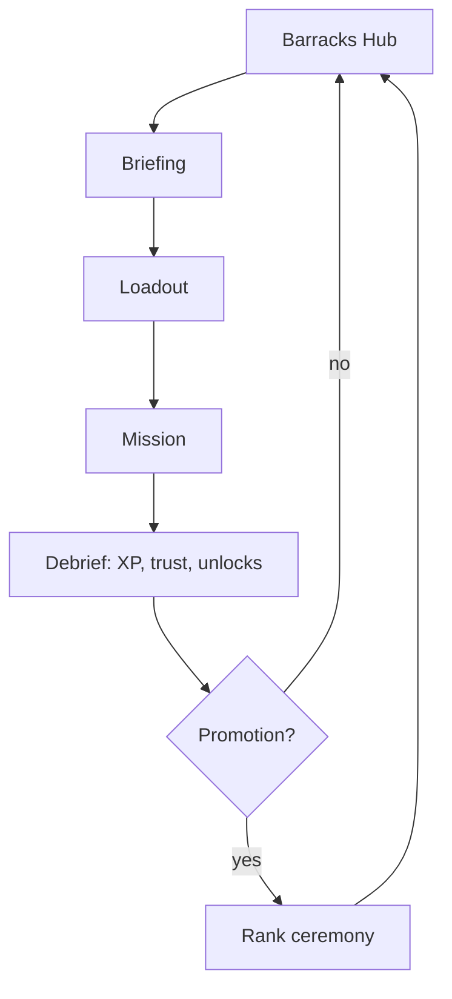

# 02 — Master Game Design Document (GDD)

**Purpose:** Top-level design of structure, loops and systems. Mechanics rules live in [06](06_GAMEPLAY_MECHANICS.md); numbers in [07](07_PLAYER_PROGRESSION_AND_ECONOMY.md). **Status:** Proposed · **Last reviewed:** 2026-10-18

## 1. Core definition
| Item | Decision |
|---|---|
| Genre | Narrative military action-progression |
| Camera | Fixed 2.5D three-quarter view (≈35° pitch, orthographic-style), follows player with look-ahead |
| Orientation | Landscape locked |
| Structure | Hub (Ridge Barracks) + missions selected from Campaign Map |
| Players | Single-player, offline |
| Fiction | Fictional nations; stylised, non-graphic |

## 2. Loops

| Loop | Length | Reward |
|---|---|---|
| Moment-to-moment | 5–30 s | Feedback: hit, ping, objective tick |
| Mission | 8–15 min | XP, Requisition Credits, story |
| Chapter | 45–70 min | Rank, new squad ability, ending-relevant flags |
| Campaign | 5–7 h (est.) | Ending, Codex completion |
| Replay | 5–10 min | Optional objectives, Veteran difficulty, medals |

## 3. Requirement catalogue
Each row is a requirement with an ID. Full acceptance criteria are in the owning file.
| ID | Feature | Player value | Owner doc | Phase |
|---|---|---|---|---|
| GDD-001 | Virtual-stick movement and sprint | Responsive control | 06 | MVP |
| GDD-002 | Aim, fire, reload with aim assist | Accessible combat | 06 | MVP |
| GDD-003 | Cover and crouch | Tactical depth | 06 | MVP |
| GDD-004 | Detection/stealth cone system | Variety | 06 | MVP |
| GDD-005 | Rescue/carry interaction | Emotional stakes | 06 | MVP |
| GDD-006 | Squad orders (Hold, Move, Use Ability) | Squad feel | 06 | MVP |
| GDD-007 | Beacon repair mini-task | Unique verb | 06 | MVP |
| GDD-008 | Dialogue with choices | Story agency | 05/08 | MVP |
| GDD-009 | Rank progression (6 ranks) | Long-term goal | 07 | MVP |
| GDD-010 | Skills (3 trees) | Build identity | 07 | MVP |
| GDD-011 | Equipment (primary, sidearm, gadget, outfit) | Customisation | 07 | MVP |
| GDD-012 | Trust meters (5) | Consequences | 07 | MVP |
| GDD-013 | Checkpoints and autosave | Mobile-friendly | 15 | MVP |
| GDD-014 | Codex/archive | Lore | 08 | MVP |
| GDD-015 | Difficulty modes | Accessibility | 06/07 | MVP |
| GDD-016 | Vehicle section (boat or truck, simple) | Rhythm | 05 | Post-MVP |
| GDD-017 | Photo mode | Delight | — | Optional |
| GDD-018 | Challenge/Replay board (local) | Replayability | 07 | Post-MVP |

## 4. Game systems summary
- **Mission objectives:** primary (required), optional (reward + trust), hidden (Codex). States: Locked, Active, Complete, Failed.
- **Failure:** player down with no revive available within 8 s (Standard), objective-critical NPC lost, timer expiry, detection fail in strict stealth missions. Retry from last checkpoint.
- **Health:** segmented (5 pips) with slow regen after 6 s out of combat; downed state revivable by squadmate.
- **AI:** state machines (Idle, Patrol, Suspicious, Alert, Search, Flee) for enemies; allies follow order set (Follow, Hold, Advance, Ability).
- **Save/Resume:** autosave at checkpoints and mission end; suspend-safe (see [15](15_DATA_MODEL_AND_SAVE_SYSTEM.md)).
- **Pause:** always available except during locked cinematics; pausing stops sim and music ducks.
- **Offline:** no network calls in MVP.

## 5. Difficulty
| Mode | Enemy damage | Aim assist | Checkpoint frequency | Intended player |
|---|---|---|---|---|
| Cadet | 0.6× | Strong | High | Story-first |
| Standard | 1.0× | Medium | Normal | Default |
| Veteran | 1.4× | Light | Sparse | Challenge |
All multipliers are `Proposed`; tune in Phase 2 playtests.

## 6. Tutorial and onboarding
Integrated into P-01 and M-101/102; no separate tutorial wall. Mechanics introduced one at a time ([05](05_CAMPAIGN_AND_MISSION_DESIGN.md) §3 matrix). Contextual prompts appear once, can be re-read in Codex → "Field Manual".

## 7. Accessibility baseline
Subtitles default on with speaker name; text size S/M/L; colour-blind palette (deuteranopia/protanopia/tritanopia-safe markers + shapes); haptics toggle; aim assist scale; hold-vs-toggle for sprint/aim; left-handed HUD mirror; reduced screen shake and flashing; high-contrast HUD option. Details in [08](08_UI_UX_AND_SCREEN_SPECIFICATIONS.md).

## 8. Decisions and rejected alternatives
| Decision | Rejected | Reason |
|---|---|---|
| 2.5D fixed camera | Free third-person 3D | Cost, mobile perf, controls |
| Local-only | Cloud saves | No backend budget, privacy simplicity |
| Linear chapters with echoes | Fully branching | Writing/testing cost |

## 9. Technical experiments needed before commit
Listed in [13](13_TECH_STACK_AND_RENDERING_DECISION.md) (EXP-01…EXP-06).
