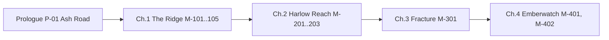

# 03 — Story, World and Lore

**Purpose:** Authoritative narrative canon. **Status:** Proposed · **Last reviewed:** 2026-10-18
All names here are canonical; other files must match. Characters: [04](04_CHARACTER_AND_FACTION_BIBLE.md). Missions: [05](05_CAMPAIGN_AND_MISSION_DESIGN.md).

## 1. World
**Republic of Corvane** — a mountain-and-river nation, capital **Aldermere**. Armed service: **Corvane Defence Corps (CDC)**. Civilian oversight: **Ministry of Provincial Security (MPS)**.
**Harlow Reach** — a border province of river valleys below the **Harrow Dam**. Twelve years ago the **Great Harrow Flood** destroyed villages including **Tessel's Ford**.
**Emberwatch** — a network of 14 hilltop beacon towers (signal fire + sensors + radio relay) built after the flood so valleys get warning. Keepers live in the towers.
**Sable Compact** — a breakaway coalition of Harlow Reach militias, former CDC soldiers and displaced villagers.
**Halvorn Ridge Academy ("the Ridge")** — CDC training academy above the Reach. Cadets are organised into **Lanterns** (squads of five). Player's squad: **Third Lantern**.

## 2. History timeline
| Year (relative) | Event |
|---|---|
| −12 | Great Harrow Flood. Tower 7 goes dark minutes before the dam surge. Thousands displaced. |
| −11 | Emberwatch built; Tower keepers recruited. Official report blames "severe weather". |
| −6 | MPS Director Lucan Pryce reallocates dam-maintenance and Emberwatch funds to border fortifications. |
| −2 | Maj. Orsolya Keth (Ridge instructor, Tower 7 investigator) finds falsified maintenance logs, is dismissed, joins displaced villagers. Sable Compact forms. |
| 0 | Campaign. Dam gate stress is critical; the Compact seizes the dam control house to force disclosure; CDC mobilises. |

## 3. The central mystery
**Question:** Why did Tower 7 go dark during the flood, and is it happening again?
**Answer (revealed gradually):** Tower 7's relay was ordered offline by an MPS maintenance-suspension directive signed by Pryce to avoid a costly evacuation while a CDC depot was relocating. The keeper, **Maren Rowe** (the protagonist's parent), refused and hand-lit the signal fire; the surge arrived before the warning could spread. Pryce has since diverted the funds that would prevent a repeat.

## 4. Protagonist
**Recruit Wren Rowe** (default given name editable; surname fixed). Age 20. Raised by relatives after Tessel's Ford was lost. Motivation: find out why Tower 7 failed; prove that people who stay and do the work matter. Flaw: over-volunteers, hides fear. Callsign **"Kindle"** is earned in M-104.

## 5. Story structure

### Prologue — "Ash Road" (P-01)
Playable opening. Wren's transport to the Ridge is caught in a flash flood; Tower 7 on the ridge does not light. Wren helps evacuate passengers, meeting **Sgt. Mara Voss** among the responders. Choice **F_MERCY_P01**: help a stranded family (slower, lose time bonus) or reach the radio first (faster, stronger first-signal).

### Ch.1 — The Ridge (M-101…M-105)
Purpose: teach mechanics; introduce Third Lantern and rival **Cadet Corin Ashdale**. Mid-chapter M-103 reveals the Ridge archives contain a Tower 7 file with pages removed. M-104 earns callsign. M-105 resolves rival tension: choose to share credit (`F_RIVAL_ALLY=true`) or win outright.

### Ch.2 — Harlow Reach (M-201…M-203)
Third Lantern is deployed as flood-relief support. M-201 escorts a supply convoy and meets Compact civilians; M-202 reaches Tower 7 and finds the keeper's log (`F_TOWER7_LOG_COPIED`: copy it or leave it for Voss); M-203 rescues villagers from a flooded quarter with a Compact medic's help. Revelation: the Compact is not the monster the briefing described.

### Ch.3 — Fracture (M-301)
Third Lantern is ordered to infiltrate a supply depot at the dam. Inside they find the suspension directive and the diverted-funds ledger. **Maj. Keth** appears, offering a parley (`F_KETH_TRUST`: take the offer, refuse, or stall). Corin's decision matters here depending on `F_RIVAL_ALLY`.

### Ch.4 — Emberwatch (M-401, M-402)
Climb to the Summit Tower hub as dam gates begin to fail. Final choice at the hub console:
| Ending | Action | Consequence |
|---|---|---|
| **Open Beacon** | Broadcast the evidence and light all towers | Valleys evacuate; Pryce exposed; government crisis; Keth surrenders |
| **Quiet Watch** | Restore warnings quietly with Keth's help; hand evidence to Brig. Thorne | Lives saved, truth delayed; trust costs |
| **Held Line** | Follow orders, secure dam by force | Dam holds at higher cost; Compact crushed; Wren carries doubt |
Availability rules in [05](05_CAMPAIGN_AND_MISSION_DESIGN.md) §6. Epilogue M-402 "Muster Roll" shows consequences per squad member.

## 7. Themes → where they appear
| Theme | Expression |
|---|---|
| Responsibility | Keeper's duty vs. orders |
| Trust | Trust meters, parley |
| Sacrifice | Maren Rowe; Bram's choice in M-203 |
| Cost of conflict | Evacuation routes, civilians on mission maps |

## 8. Sequel hook (justified, optional)
If Open Beacon: Aldermere inquiry begins. Single post-credit line; campaign is complete without it.

## 9. Antagonism design
Keth's goal is disclosure and protection of the Reach; her method (seizing the dam) endangers civilians. Pryce is the true concealer but is mostly offscreen; the confrontation is a choice, not a boss fight.
