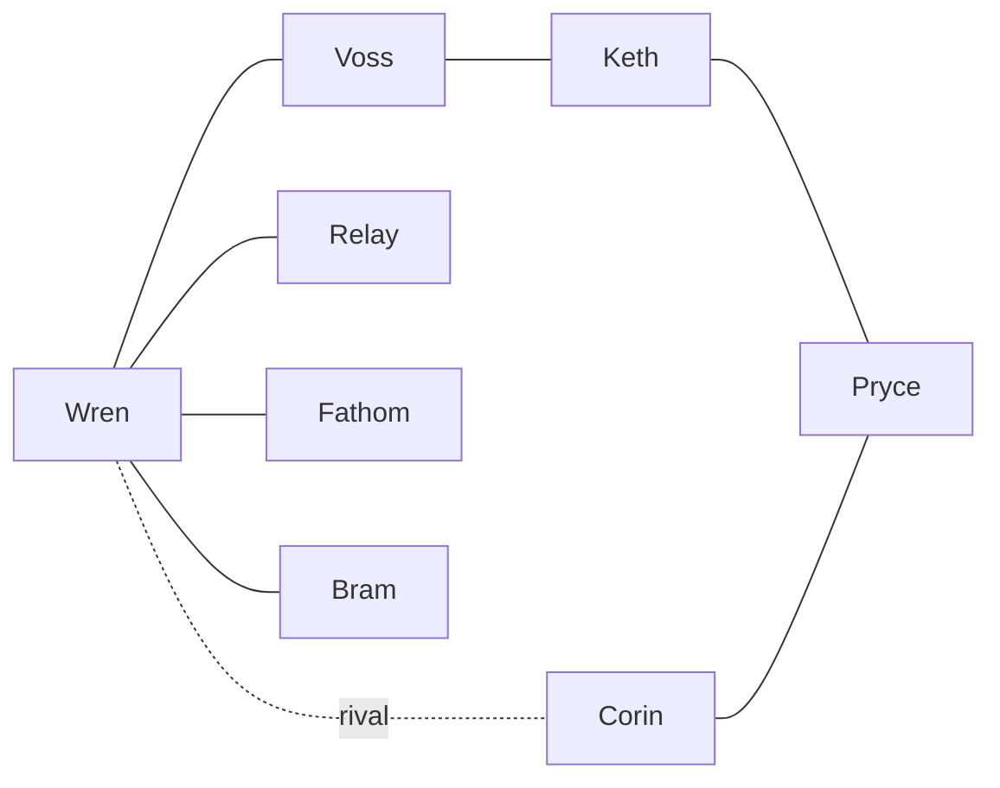

# 04 — Character and Faction Bible

**Purpose:** Authoritative character data. **Status:** Proposed · **Last reviewed:** 2026-10-18
Canon from [03](03_STORY_WORLD_AND_LORE.md). Ages are adult (≥19) for all combat characters. Missions refer to IDs in [05](05_CAMPAIGN_AND_MISSION_DESIGN.md).

## 1. Cast overview
| ID | Name | Callsign | Role | Age | Missions |
|---|---|---|---|---|---|
| CH-01 | Wren Rowe | Kindle | Protagonist | 20 | All |
| CH-02 | Sgt. Mara Voss | Anvil | Third Lantern instructor | 41 | P-01, 101–105, 201–203, 301, 401, 402 |
| CH-03 | Cdt. Dev Okonkwo-Reyes | Relay | Comms/tech | 20 | 101–105, 201–203, 301, 401, 402 |
| CH-04 | Cdt. Hana Lindqvist | Fathom | Scout/medic | 21 | 101–105, 201–203, 301, 401, 402 |
| CH-05 | Cdt. Tobias "Bram" Hale | Bulwark | Engineer/heavy | 22 | 101–105, 201–203, 301, 401, 402 |
| CH-06 | Cdt. Corin Ashdale | Gale | Rival | 21 | 101, 102, 105, 301, 401, 402 |
| CH-07 | Maj. Orsolya Keth | Cinder | Sable Compact commander | 46 | 202 (voice), 203, 301, 401 |
| CH-08 | Director Lucan Pryce | — | MPS Director (hidden hand) | 58 | 301 (documents), 401 (comms) |
| CH-09 | Brig. Adaeze Thorne | Lantern Actual | Ridge Commandant | 52 | 101, 105, 301, 401, 402 |
| CH-10 | Medic Iri Sedge | — | Compact medic | 33 | 203 |

## 2. Character sheets (condensed template)
Template fields: Appearance/silhouette · Personality · Strengths/weaknesses · Background · Motivation · Relationships · Voice · Animation/expression · Gameplay purpose · Arc (start → end).

### CH-01 Wren Rowe "Kindle"
- **Silhouette:** Slim, oversized training jacket, messenger-style satchel with a small brass flint tin. Customisable (3 body, 4 hair, 3 skin-tone presets in MVP).
- **Personality:** Earnest, observant, over-eager. Weakness: hides fear, over-volunteers.
- **Background/Motivation:** Lost Tessel's Ford; parent Maren Rowe was Tower 7 keeper.
- **Voice:** Short, practical lines; dry humour under stress.
- **Animations:** idle-nervous→idle-steady (changes after M-104), run, crouch, carry, climb, signal-flare throw. Expressions: determined, afraid, relieved.
- **Gameplay:** Player avatar. **Arc:** Anxious volunteer → decisive Section Leader.

### CH-02 Sgt. Mara Voss "Anvil"
Broad-shouldered, grey-streaked braid, ember-orange armband. Calm, blunt, fair. Ex-flood-response. Knew Maren Rowe. Teaches by letting recruits fail safely. Gameplay: tutorial voice, squad order unlock. Arc: guarded duty → chooses conscience (variable by trust). **Trust gate:** Trust ≥60 unlocks private scene in M-202.

### CH-03 Dev Okonkwo-Reyes "Relay"
Round glasses, shoulder-mounted antenna rig, quick talker, jokes. Insecure about field performance. Gameplay: signal jamming, door hacks, map pings (ability **Relay Ping**). Arc: observer → confident operator who retransmits the final broadcast.

### CH-04 Hana Lindqvist "Fathom"
Lean, cropped hair, medic satchel with white ember-mark, soft voice. Meticulous, protective. Pulled between orders and care. Gameplay: heal/revive, quiet scouting (**Field Dressing**). Arc: rule-follower → advocates for civilians.

### CH-05 Tobias "Bram" Hale "Bulwark"
Tall, heavy build, tool-belt, shield-plate vest. Gentle, steady, afraid of being useless. Gameplay: breach, carry heavy objects, cover deployment. Arc: follower → makes the sacrifice-adjacent choice in M-203 (**holds the flood door**); survives in all endings but with an injury that depends on trust.

### CH-06 Corin Ashdale "Gale"
Immaculate uniform, silver cuff, upright posture. Competitive, hiding family pressure (father is an MPS official). Gameplay: rival score in M-105; ally AI in M-301 if `F_RIVAL_ALLY`. Arc: rival → either ally who defies orders, or opponent who follows them.

### CH-07 Maj. Orsolya Keth "Cinder"
Weathered coat, ash-grey scarf, rebuilt radio. Controlled, patient, moral certainty with blind spots. Former Ridge instructor; taught Voss. Gameplay: parley, final-chapter negotiation. Arc: crusader → accountable leader.

### CH-08 Director Lucan Pryce
Seen mostly via documents and voice. Smooth, polite, procedural. Rationalises: "A managed loss now prevents panic."

### CH-09 Brig. Adaeze Thorne
Silver crop, cane she rarely needs. Honest but constrained. Gameplay: briefing giver. Arc: obeys → decides what orders are worth.

### CH-10 Iri Sedge
Compact medic in patched Corvane gear; mirrors Hana. Appears M-203 only.

## 3. Relationship model
Trust values 0–100 for Voss, Relay, Fathom, Bram, Corin, defined in [07](07_PLAYER_PROGRESSION_AND_ECONOMY.md). Default 40 (Corin 20).

## 4. Factions
| Faction | Colours / insignia | Goal | Gameplay presence |
|---|---|---|---|
| CDC | Slate green + ember-orange; lantern mark | Order, protect nation | Player faction |
| Sable Compact | Charcoal + rust; broken-ring mark | Disclosure, protect Reach | Opposition then ally (by ending) |
| MPS | Navy + white; shield mark | Control narrative | Offscreen |

## 5. Dialogue style guide
Short lines (≤14 words typical), concrete nouns, no jargon dumps. Banter during traversal; silence in tension. No real-world slogans or locations.
