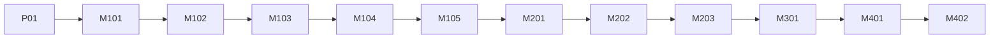

# 05 — Campaign and Mission Design

**Purpose:** Authoritative mission list, structure and ending rules. **Status:** Proposed · **Last reviewed:** 2026-10-18
Story canon: [03](03_STORY_WORLD_AND_LORE.md). Mechanics: [06](06_GAMEPLAY_MECHANICS.md). Rewards: [07](07_PLAYER_PROGRESSION_AND_ECONOMY.md).

## 1. Scope labels
| Label | Meaning |
|---|---|
| MVP | In first release |
| Post-MVP | Planned after release |
| Optional | Only if schedule allows |
**Vertical slice = P-01 + M-101 + M-102** (Phase 2). **MVP = 12 entries** (P-01, M-101–105, M-201–203, M-301, M-401, M-402).

## 2. Campaign roadmap
| ID | Title | Chapter | Dominant verb | Duration (est.) | Difficulty | Scope |
|---|---|---|---|---|---|---|
| P-01 | Ash Road | Prologue | Rescue/evacuate | 8 min | 1 | MVP |
| M-101 | First Muster | 1 | Traverse/obstacle | 8 min | 1 | MVP |
| M-102 | Range Day | 1 | Aim/shoot | 10 min | 2 | MVP |
| M-103 | Night Navigation | 1 | Stealth/recon | 12 min | 2 | MVP |
| M-104 | Drowned Quarry Drill | 1 | Rescue + squad orders | 12 min | 3 | MVP |
| M-105 | The Lantern Trial | 1 | Timed coordination vs rival | 10 min | 3 | MVP |
| M-201 | Dam Road Escort | 2 | Escort/defence | 14 min | 3 | MVP |
| M-202 | Tower Seven | 2 | Recon + beacon repair + discovery | 14 min | 3 | MVP |
| M-203 | Flooded Quarter | 2 | Rescue under time pressure | 15 min | 4 | MVP |
| M-301 | The Ledger | 3 | Infiltration + parley choice | 18 min | 4 | MVP |
| M-401 | Emberwatch Summit | 4 | Climb + beacon chain + choice | 18 min | 5 | MVP |
| M-402 | Muster Roll | 4 | Cinematic epilogue (light play) | 6 min | 1 | MVP |
| M-204 | Ridge Ambush | 2 | Combat defence | 12 min | 4 | Post-MVP |
| M-302 | Keth Parley Run | 3 | Chase/dialogue | 12 min | 4 | Post-MVP |
| M-303 | Collapse | 3 | Traversal escape | 12 min | 4 | Post-MVP |



## 3. Mechanic introduction matrix
| Mechanic | Introduced | Reused |
|---|---|---|
| Movement/sprint (MECH-001) | P-01 | all |
| Interact/carry (MECH-006) | P-01 | 104, 203 |
| Traversal (MECH-009) | M-101 | 202, 401 |
| Aim/fire (MECH-002) | M-102 | 105, 201, 301, 401 |
| Cover (MECH-003) | M-102 | 201, 301 |
| Stealth (MECH-004) | M-103 | 202, 301 |
| Squad orders (MECH-007) | M-104 | 105+, all |
| Beacon repair (MECH-008) | M-202 | 401 |
| Timer (MECH-010) | M-101 | 105, 203, 401 |

## 4. Mission specifications
Common fields for every mission: checkpoint rule = after each primary sub-objective; failure = see GDD §4; restart = last checkpoint; assets = environment kit + listed characters; budget = Medium profile ≤ 150 MB resident (target, [17](17_PERFORMANCE_AND_DEVICE_COMPATIBILITY.md)).

### P-01 Ash Road
- **Location:** Ash Road, below Tower 7. **Purpose:** Hook; establish Tower 7 dark and Voss.
- **Briefing:** None; starts mid-event. **Start:** Transport tilted in rising water.
- **Primary:** Move civilians to the culvert; reach roadside radio. **Optional:** Save the stranded family (F_MERCY_P01).
- **Mechanics:** Move, interact, carry. **Encounters:** Environmental only. **Characters:** Wren, Voss.
- **Checkpoints:** After first carry, after radio. **Fail:** timer expiry or civilians lost >2.
- **Rewards:** 150 XP, Codex "Tower 7". **Cutscene:** 30 s intro, 20 s end. **Next:** M-101.

### M-101 First Muster
- **Location:** Ridge Parade Ground and obstacle course. **Purpose:** Introduce Third Lantern, traversal, timer.
- **Primary:** Complete course under 3:00 (soft target; no fail on time). **Optional:** Find 3 hidden lantern tokens.
- **Characters:** Voss, Relay, Fathom, Bram, Corin (cameo), Thorne (briefing).
- **Checkpoint:** each obstacle zone. **Fail:** none (training fall = respawn). **Rewards:** 250 XP, 100 RC.

### M-102 Range Day
- **Location:** Ridge firing range. **Primary:** Hit 3 target sets (static, moving, cover pop-up). **Optional:** ≥80% accuracy; use cover correctly.
- **Mechanics:** aim, fire, cover, reload. **Characters:** Voss, Corin (competes). **Fail:** none; retry per set. **Rewards:** 300 XP; first weapon upgrade token.

### M-103 Night Navigation
- **Location:** Ridge forest at night. **Primary:** Reach 4 waypoints undetected by instructor patrols. **Optional:** Photograph a "ghost" cache (Codex entry on missing Tower 7 pages).
- **Mechanics:** stealth, noise, cone. **Fail:** detected 3× → restart waypoint. **Rewards:** 350 XP; archive hint flag `F_ARCHIVE_HINT`.

### M-104 Drowned Quarry Drill
- **Location:** Flooded quarry (training). **Primary:** Rescue 3 mannequin-civilians with squad orders. **Optional:** No squad member downed.
- **Mechanics:** carry + orders. **Beat:** earns callsign **Kindle**. **Rewards:** 400 XP; unlocks Skill tree 1 slot 2.

### M-105 The Lantern Trial
- **Location:** Mixed arena. **Primary:** Complete a 3-stage timed course against Corin's score. **Choice:** after finish, share credit (F_RIVAL_ALLY=true) or claim it (false).
- **Rewards:** 450 XP; promotion checks per [07](07_PLAYER_PROGRESSION_AND_ECONOMY.md). **Next:** deployment briefing.

### M-201 Dam Road Escort
- **Location:** Harrow Dam Road. **Primary:** Escort 3 supply trucks to Camp Linden. **Optional:** Talk to Compact refugees (+Trust Fathom).
- **Mechanics:** escort, cover, light firefights, squad orders. **Fail:** all trucks lost. **Rewards:** 500 XP.

### M-202 Tower Seven
- **Location:** Tower 7 ruin. **Primary:** Reach the tower via stealth + traversal; repair beacon node; find the keeper's log.
- **Choice:** F_TOWER7_LOG_COPIED (copy for Relay, or leave for Voss). **Trust scene:** Voss ≥60 unlocks backstory scene.
- **Rewards:** 550 XP; Codex arc "Maren Rowe".

### M-203 Flooded Quarter
- **Location:** Lower Reach quarter. **Primary:** Evacuate ≥ 6/8 civilians before surge timer. **Beat:** Bram holds the flood door; Iri Sedge helps.
- **Fail:** <6 saved when timer ends. **Rewards:** 600 XP; ending-relevant `F_BRAM_HELD` always true; Bram trust effect.

### M-301 The Ledger
- **Location:** Dam depot. **Primary:** Infiltrate, copy ledger, reach control room. **Choice:** F_KETH_TRUST ∈ {accept, stall, refuse}.
- **Mechanics:** all prior. **Fail:** alert level 3 with no cover. **Rewards:** 700 XP; evidence token `E_LEDGER`.

### M-401 Emberwatch Summit
- **Location:** Summit Tower hub. **Primary:** Climb, repair three beacon nodes under timer, reach console, make the ending choice.
- **Fail:** Timer or squad down. **Rewards:** 900 XP + ending tag.

### M-402 Muster Roll
- **Purpose:** Epilogue slideshow-cinematic with light movement at the memorial; character outcomes per ending.

## 5. Mission data example (config; see [15](15_DATA_MODEL_AND_SAVE_SYSTEM.md))
```json
{
  "id": "M-202",
  "chapter": 2,
  "title": "Tower Seven",
  "scope": "MVP",
  "objectives": [
    {"id": "reach_tower", "type": "reach", "required": true},
    {"id": "repair_node", "type": "beacon_repair", "required": true},
    {"id": "find_log", "type": "interact", "required": true}
  ],
  "choices": [{"id": "F_TOWER7_LOG_COPIED", "class": "campaign"}],
  "rewards": {"xp": 550, "rc": 150}
}
```

## 6. Ending rules (authoritative)
| Ending | Required flags | Notes |
|---|---|---|
| Open Beacon | `F_TOWER7_LOG_COPIED=true` AND `E_LEDGER` collected AND Relay trust ≥ 50 | Best-resolution ending |
| Quiet Watch | `F_KETH_TRUST ∈ {accept, stall}` AND `E_LEDGER` | Compromise |
| Held Line | Always available | Default fallback |
If a requirement is missing, the option is shown greyed with the reason (no hidden gating).

## 7. Cutscene needs (MVP, 5 moments)
1. P-01 opening; 2. M-104 callsign; 3. M-202 log discovery; 4. M-301 Keth encounter; 5. M-401 final broadcast. ≤ 45 s each (animated stills + in-engine).

## 8. Acceptance (campaign level)
| ID | Criterion |
|---|---|
| CAM-001 | All 12 missions launch, complete, and unlock the next |
| CAM-002 | Each ending reachable in test saves |
| CAM-003 | Failure and retry never lose earned prior-mission progress |
| CAM-004 | No two consecutive missions share the same dominant verb (PIL-2) — `Needs Validation` for M-104→M-105 |
