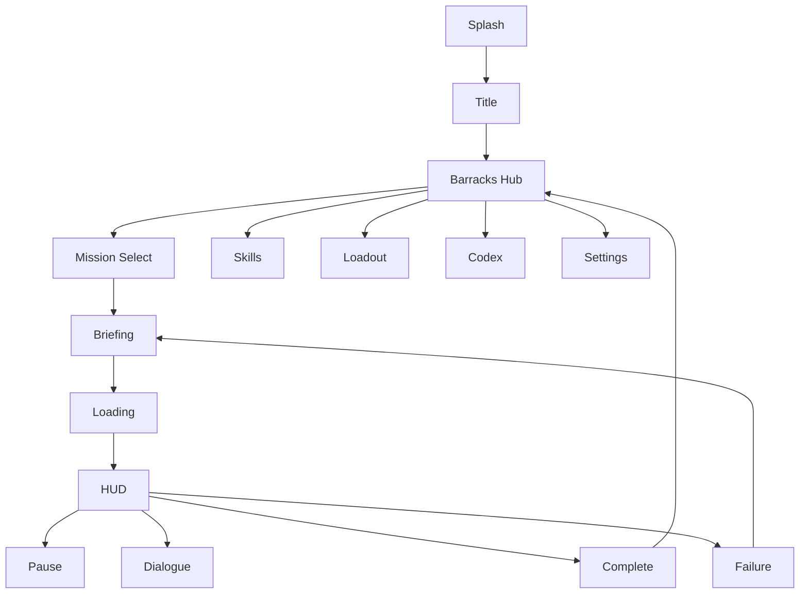

# 08 — UI/UX and Screen Specifications

**Purpose:** Authoritative screen list, layout, states and tokens. **Status:** Proposed · **Last reviewed:** 2026-10-18
Visual language: [09](09_VISUAL_ART_DIRECTION.md). Mechanics: [06](06_GAMEPLAY_MECHANICS.md).

## 1. Global decisions
| Item | Decision |
|---|---|
| Orientation | Landscape locked for **all** screens (single orientation avoids reflow bugs) |
| Safe areas | Respect notches/cutouts and gesture bars; HUD margin = max(safe inset, 16 dp) |
| Edge-to-edge | Required; Android 16 targeting removes opt-out (see [21](21_GOOGLE_PLAY_RELEASE_PLAN.md)) |
| Back button/gesture | Mission: opens Pause. Menus: go up one level. Main menu: confirm exit. Cinematic: skip prompt. Must use platform predictive-back APIs |
| Min touch target | 48×48 dp (HUD action buttons 64 dp) |
| Text | Min 14 sp body, scalable S/M/L |
| Empty/error states | Every list screen has Empty + Error + Loading variants (skeleton or spinner after 300 ms) |

## 2. Design tokens
| Token | Value | Use |
|---|---|---|
| color.ember | #E8742C | Primary action |
| color.slate | #2F4A3F | CDC surfaces |
| color.night | #0F1B24 | Backgrounds |
| color.ash | #8A9199 | Secondary text |
| color.bone | #E9E4D8 | Primary text on dark |
| color.amber | #F2B33D | Warnings/objectives |
| color.alert | #D1423B | Danger |
| color.safe | #5FAE6B | Success |
| color.water | #3B8FA6 | Flood/info |
| space | 4, 8, 12, 16, 24, 32 | Spacing scale |
| radius | 6 (chips), 12 (cards), 20 (modals) | |
| elevation | e0/e1/e2 via shadow+border | |
| font.display | Condensed sans (licensed, `Needs Validation`) | Titles |
| font.body | Humanist sans | Text |
Button states: default, pressed (−8% lightness), disabled (40% opacity), focused (2 dp bone outline).
Contrast: text/background ≥ 4.5:1; large text ≥ 3:1 (checked in QA-A11Y).

## 3. Screen specifications
Columns: Purpose · Layout · Primary / secondary actions · Navigation · States · Notes/Acceptance. Accessibility labels follow pattern `"<Action> — <context>"`.

| # | Screen | Purpose | Layout & components | Primary / Secondary | Navigates to | States & notes |
|---|---|---|---|---|---|---|
| 1 | Splash | Branding + init | Centered logo, thin progress bar | — | First launch / Title | Loading assets; error → "Retry" + safe mode; max 3 s typical |
| 2 | First launch | Consent/basic prefs | Language, subtitle default, difficulty pick | Continue / Skip | Title | Privacy note link; no data collection prompt in MVP |
| 3 | Title | Entry | Key art left, buttons right | Continue (if save) / New Campaign / Settings | Main Menu | Back = exit confirm |
| 4 | Main menu (Barracks) | Hub | Scene backdrop; tiles: Campaign, Squad, Loadout, Skills, Codex, Settings | Campaign / others | each | Badge dots for unspent MP/new Codex |
| 5 | Continue | Resume latest save | Card: chapter, rank, time, thumbnail | Resume / Choose slot | Mission or Hub | Corrupt save → recovery dialog (#27) |
| 6 | New campaign | Start | Name entry, appearance, difficulty | Begin / Back | P-01 | Warn if overwriting slot |
| 7 | Chapter/Mission select | Choose mission | Horizontal chapter rail + mission cards | Select / Back | Briefing | Locked state with reason; Empty not applicable |
| 8 | Mission briefing | Context | Map thumbnail, objectives, characters, risk | Deploy / Loadout | Loading | Skippable text; subtitles |
| 9 | Loading | Transition | Tip + progress | — | Mission | Never > 8 s target on Medium (estimate); cancel not allowed |
| 10 | HUD | In-game | See wireframe §4 | — | Pause | Opacity adjustable |
| 11 | Pause | Control | Dim, centre card: Resume, Settings, Objectives, Restart Checkpoint, Quit to Hub | Resume | | Confirm destructive actions |
| 12 | Objective update | Feedback | Top-left toast ≤ 3 s | — | — | Doesn't block input |
| 13 | Dialogue/choices | Story | Portrait left, text box bottom, up to 3 choice buttons | Choose/Next | | Auto-advance off; Skip line on tap; log accessible |
| 14 | Mission complete | Debrief | Medal, XP bar, trust changes, unlocks | Continue / Replay | Hub | Count-up skippable |
| 15 | Mission failure | Retry | Short cause text | Retry / Loadout / Quit | | After 3 fails offer "Assist options" |
| 16 | Academy/training select | Replay training | Cards for M-101…105 | Select | Briefing | Locked until completed |
| 17 | Character/squad profile | Learn | Portrait, bio, trust meter, abilities | Back | | Spoiler-gated entries |
| 18 | Skills | Spend MP | 3 tree columns, node details | Spend / Respec | | Insufficient MP disabled w/ reason |
| 19 | Equipment/loadout | Choose gear | Slot list + item detail + stats compare | Equip / Buy | | Insufficient RC shown |
| 20 | Rewards/promotion | Celebrate | Rank card | Continue | | Haptic + sound; reduced-motion variant |
| 21 | Campaign map | Orientation | Stylised map with nodes and routes | Select node | Briefing | Fog for undiscovered |
| 22 | Codex | Lore | Tabs: Characters, Places, Documents, Field Manual | Open entry | | Empty: "Nothing found yet" |
| 23 | Settings | Preferences | Tabs: Audio, Graphics, Controls, Accessibility, Data, About | Save auto | | Changes apply live |
| 24 | Audio | Master, Music, SFX, Voice sliders + mute | | | | Persist instantly |
| 25 | Graphics/performance | Quality: Auto/Low/Med/High; FPS cap 30/60; particles | | | | Warning when High on low RAM |
| 26 | Accessibility | Subtitle size, colour-blind mode, haptics, assists, mirrored HUD, reduced motion | | | | Preview panel |
| 27 | Save-data & recovery | Manage/restore | Slots, last good backup, Export diagnostics | Restore / Delete | | Delete needs hold-to-confirm |
| 28 | Privacy & legal | Policy | Local text + external link, licences, version | Back | | Works offline (bundled copy) |

## 4. HUD wireframe (landscape, 20:9 reference)
```
+---------------------------------------------------------------+
| [II] Objective: Repair node 2/3    [00:42]          [Ping][?] |
|                                                               |
|                                                               |
| (  )  stick zone                          [Reload] [Cover]    |
| HP ▮▮▮▮▯  stamina ──                      [Interact] [FIRE]   |
| Squad: R F B   [Orders]                    Ability [A]        |
+---------------------------------------------------------------+
```
Rules: leave centre 60% clear; HUD alpha 70% idle; critical alerts use icon + colour + shape.

## 5. Navigation graph


## 6. Responsive rules
Aspect 16:9 → 21:9; scale UI by smallest dimension; tablet keeps same layout with larger margins. Foldables: treated as standard landscape (`Needs Validation`).

## 7. Acceptance
| ID | Criterion |
|---|---|
| UI-001 | All 28 screens reachable and back-navigable |
| UI-002 | No HUD element clipped by cutouts on test devices |
| UI-003 | Touch targets ≥ 48 dp verified by automated layout test |
| UI-004 | Every interactive element has an accessibility label |
