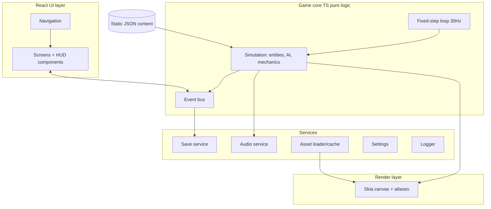

# 12 — Technical Architecture

**Purpose:** Authoritative architecture of the chosen approach. **Status:** Proposed (`Needs Validation` pending EXP-01…EXP-06 in [13](13_TECH_STACK_AND_RENDERING_DECISION.md)) · **Last reviewed:** 2026-10-18
Implementation plan: [14](14_REACT_NATIVE_IMPLEMENTATION_PLAN.md). Data: [15](15_DATA_MODEL_AND_SAVE_SYSTEM.md).

## 1. Principle
Simplest architecture that delivers the experience: one JS/TS runtime, one Skia canvas for gameplay, React for menus, local JSON content, local saves. No backend.

## 2. Layered diagram

## 3. Module responsibilities
| Module | Owns | Must not |
|---|---|---|
| `game-core` | Simulation, AI, mechanics, deterministic RNG | Import React or platform APIs |
| `render` | Draw sim snapshot to Skia, camera, parallax | Mutate sim |
| `ui` | Screens, HUD, dialogue | Contain game rules |
| `content` | Mission/character/item JSON + schema | Contain player progress |
| `services/save` | Versioned persistence, backup, migration | Run during sim tick |
| `services/audio` | Buses, music layers, ducking | Block render |
| `services/assets` | Preload, cache, memory eviction | |
| `services/settings` | Preferences and quality profile | |
| `services/logger` | Local ring-buffer logs | Send data off device (MVP) |

## 4. Gameplay state
- **Sim state** lives in game-core (plain objects, snapshot per tick).
- **UI state** via a small store (Zustand `Proposed`); HUD subscribes to selected fields at ≤ 10 Hz to avoid re-render storms.
- **Meta state** (campaign) in Save service, hydrated at boot.

## 5. Navigation
React Navigation or Expo Router (`Needs Validation` for landscape + predictive-back behaviour). Single root stack; gameplay screen hosts the canvas and overlays; Pause/Dialogue are overlay routes.

## 6. Mission/content configuration
JSON per mission validated by schema at build time ([15](15_DATA_MODEL_AND_SAVE_SYSTEM.md)). Mission scripts use a small declarative trigger/action format (no embedded code execution).

## 7. Asset loading
Manifest per mission → preload atlases at Loading screen → LRU cache; on memory warning, drop non-active parallax layers and reduce quality profile.

## 8. Error handling and logging
Typed `Result` for services; global error boundary around UI; sim exceptions → safe pause + "Return to Hub" with log reference; logs local only; user can "Export diagnostics" as a file they choose to share.

## 9. Security considerations
No network in MVP; no secrets; saves are integrity-checked (hash) but not encryption-protected (offline single-player; tamper is acceptable risk). Release builds with minification; signing keys outside repo ([19](19_PRIVACY_SECURITY_AND_COMPLIANCE.md)).

## 10. Environment and build configs
| Config | Purpose |
|---|---|
| `development` | Dev client, debug menu, verbose logs |
| `preview` | Internal APK for testers, release JS |
| `production` | AAB, signed via Play App Signing |
Environment variables only for non-secret flags (e.g. `ENABLE_DEBUG_MENU`).

## 11. Offline-first
Entire game bundled/cached locally. Optional future network features must degrade silently.

## 12. Testing hooks and release pipeline
Deterministic sim enables headless unit/replay tests ([20](20_TESTING_AND_QUALITY_ASSURANCE.md)). Pipeline: CI (lint, types, tests) → EAS/Gradle build → internal track ([21](21_GOOGLE_PLAY_RELEASE_PLAN.md)).

## 13. Requirements
| ID | Requirement | Phase |
|---|---|---|
| TECH-001 | game-core has zero React/RN imports (lint-enforced) | MVP |
| TECH-002 | Fixed 30 Hz sim, render interpolated to display rate | MVP |
| TECH-003 | All content validated by schema in CI | MVP |
| TECH-004 | Save service atomic writes with backup | MVP |
| TECH-005 | Quality profile switch without restart | MVP |
