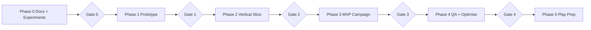

# 22 — MVP Roadmap and Phase Gates

**Purpose:** Phased plan with gates. **Status:** Proposed · **Last reviewed:** 2026-10-18
No calendar dates: team size is unknown ([00](00_PROJECT_BRIEF.md) A-01). Effort estimates in [23](23_TASK_BACKLOG_AND_ACCEPTANCE_CRITERIA.md) are preliminary.

| Phase | Goals | Deliverables | Dependencies | Key tasks | Acceptance (gate) | Risks | Definition of done |
|---|---|---|---|---|---|---|---|
| **0 Docs & validation** | Lock scope, validate tech | This doc set; EXP-01…06 results; ADR-001 approved | Founder review | TASK-001…008 | Gate 0: EXP-01…05 pass on a real mid-range device or fallback decision recorded; DEC-001 Approved | Experiments fail → switch to Option C | Results logged in [26](26_RISK_REGISTER_AND_DECISION_LOG.md) |
| **1 Playable prototype** | Smallest loop: launch → train → move → objective → feedback | Greybox build with stick, one objective, HUD, save stub | Gate 0 | TASK-010…016 | Gate 1: Player can finish a greybox mission on device at ≥ 30 FPS | Input latency | Demo build on internal track |
| **2 Vertical slice** | One polished mission set showing art/audio/story/progress | P-01, M-101, M-102 polished; 1 cutscene; ranks R1–R2; save/resume | Gate 1; first-pass art/audio | TASK-020…032 | Gate 2: Playtest ≥ 5 players; tutorial completion ≥ 85% target; art/audio reviewed | Art throughput | Founder sign-off; perf measured |
| **3 MVP campaign** | Complete 12-entry campaign + endings | All MVP missions, skills, loadout, codex, 5 cinematics | Gate 2 | TASK-040…060 | Gate 3: Playable start to finish; all endings reachable | Scope creep; writing volume | Feature freeze |
| **4 QA & optimisation** | Stability, perf, saves | Bug-fixed build; device matrix results | Gate 3 | TASK-070…078 | Gate 4: QG-1…QG-7 | Device fragmentation | Release candidate |
| **5 Play preparation** | Release artifacts | Signed AAB, listing, policies, closed test | Gate 4 | TASK-080…090 | Gate 5: Closed test passed; checklist REL-001…010 done | Policy changes/rejection | Submission ready |

## Scope control rules
1. Nothing enters MVP without a mission, UI, architecture, asset, backlog and test entry.
2. Post-MVP list: M-204, M-302, M-303, vehicle sections, challenge board, photo mode.
3. Cutting order if behind: cosmetic outfits → Codex Documents tab → optional objectives → cinematic #2/#4 (convert to stills) → Veteran medals.
