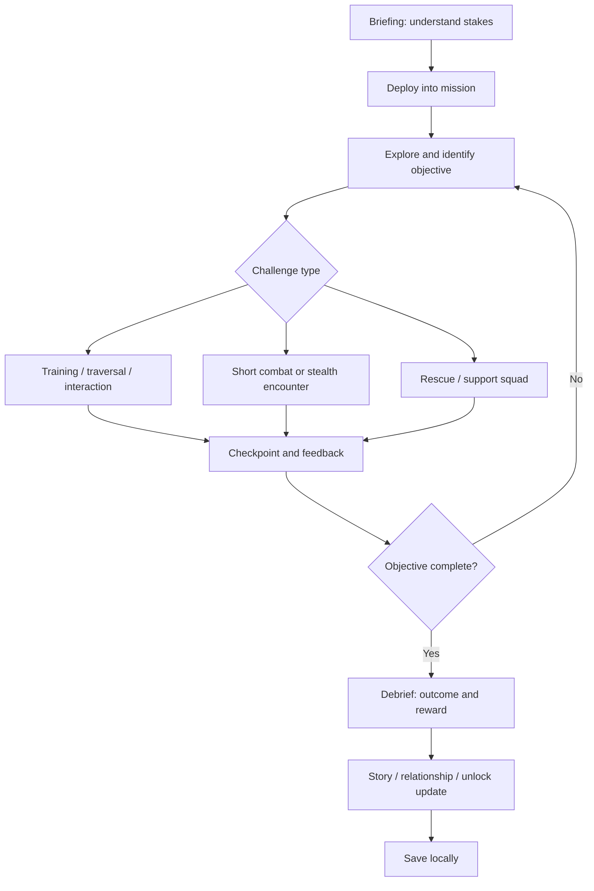

# 02 — Master Game Design Document

**Purpose:** Primary specification for player-facing game behavior.  
**Status:** Proposed; mechanics require prototype validation  
**Last reviewed:** 2026-10-19

## 1. Overview

*Operation: Emberwatch* is an offline-first, single-player, third-person mobile action-adventure. The player controls recruit Mara Venn through academy training and a five-mission MVP campaign about restoring emergency-warning relays and uncovering a failure in the civil evacuation system. Combat is one tool among movement, observation, rescue, escort, interaction and dialogue.

## 2. Core loop

Secondary loops: optional objective → performance medal → cosmetic or codex unlock; dialogue choice → squad response → later support variant; replay mission → improve best score, never lose rank.

## 3. Camera, movement and controls

**Orientation:** landscape only. **Perspective:** third-person over-the-shoulder, slightly elevated, right-hand camera look. No orientation switch during gameplay.

| Input | Default touch mapping | Response |
|---|---|---|
| Move | Left virtual stick | Camera-relative walking; sprint when stick is pushed beyond a configurable threshold or sprint button is pressed. |
| Look | Drag right half of screen | Rotate camera; vertical pitch clamped to prevent disorienting flips. |
| Aim | Hold aim button | Camera eases to the shoulder aim offset; aim assist gently favors visible valid targets. |
| Fire | Press fire button while aiming or use assisted hip-fire | Fictionalized hitscan or projectile implementation; tuning decision belongs to prototype. No real-world ballistic simulation. |
| Interact | Contextual action button | Use, help, open, activate, carry or speak based on the nearest valid target. Label names the action. |
| Reload | Reload button | Plays readable animation; if not needed, gives subtle no-op feedback. |
| Sprint | Sprint button | Stamina-free for MVP; short speed boost limited by navigation/collision, not a resource bar. |
| Utility | Contextual single ability | Only one MVP utility at a time (e.g., flare beacon or field patch). |
| Pause | Top-right pause | Freezes game simulation, not audio slider UI; pause must not spend mission time. |

Control settings: left/right-handed HUD swap; camera sensitivity; aim sensitivity; aim assist off/low/high; vibration on/off; control size 85–120%; invert vertical look. Touch target baseline is 48dp where feasible; important actions are separated to reduce accidental presses.

## 4. Mission rules

Every mission has one primary objective, zero to two optional objectives, one or more checkpoints, clear success and failure conditions, and a debrief. Objectives use a visible verb + subject + location (“Restore the north relay — Relay Station A”). Optional objectives never block story completion. A mission fails only for explicit authored states (e.g., protected civilian evacuated too late or protagonist incapacitated); ordinary time limits are reserved for clearly telegraphed sequences.

- A restart returns to the most recent checkpoint or mission start by explicit player choice.
- Retry never silently resets campaign choice history from before the mission.
- If a required NPC becomes stuck or despawns, trigger a recoverable checkpoint reset or safe completion fallback; do not strand the player.
- Objective updates are logged in the mission journal and spoken only when VO exists; text always remains available.

## 5. Health, damage and recovery

MVP uses a 3-segment health display rather than a detailed numeric simulation. Damage has a short invulnerability window to avoid rapid consecutive hits; exact duration is tuned in prototype. At zero health, fade to a mission-retry screen and offer “Retry checkpoint” and “Restart mission”. A field patch can restore one segment at a designated safe moment. No permanent injury, gore, hunger or survival meters.

Damage sources are authored combat projectiles, hazards and scripted impact zones. Friendly fire is disabled. Civilian characters cannot be targeted; the reticle never locks onto them. Fire input is suppressed when a friendly/civilian intersects the narrow firing safety cone in MVP; test UX to avoid frustrating false blocks.

## 6. Combat and target readability

Combat is an arcade action mechanic, not a real-world weapon simulation. Enemies are fictional hostile actors with clear telegraphs, generous reaction time and small behavior states: patrol, notice, seek cover, attack, stagger, retreat/disabled. MVP supports at most three hostile AI agents active in a combat cell until profiling proves a higher safe limit. Avoid complex ballistic penetration, detailed attachments, advanced suppression modeling or realistic tactics.

Aiming uses a clear reticle, aim assist, hit marker, enemy reaction animation and low-intensity audio cue. Do not rely on color alone to indicate target state. Enemy silhouettes and teams use distinct shape and icon cues. No dismemberment, blood pools or execution mechanics.

## 7. Squad support

One squadmate is active with three authored orders: **Follow**, **Hold Position**, **Assist**. The order is a simple context button/radial with large touch targets. The companion follows on a nav path, avoids blocking the player, and can revive/assist only at authored scripted windows. Orders are narrative flavor and support, not a complex strategy layer. If navigation fails, teleport the ally to a safe authored anchor after a short delay, with a transition that avoids appearing in the player's view.

## 8. Stealth and detection

Stealth is a short optional system in one mission. Enemies have a suspicion state represented by an on-screen icon and audible cue; no fine-grained real-world sensor simulation. Line-of-sight checks use game geometry, and suspicious noise can shift an enemy from patrol to investigate. Detection raises encounter pressure but does not instantly fail the mission. The player can recover by breaking line of sight or moving to a designated safe zone. Avoid mechanics that imply training value for real-world evasion.

## 9. Training

Training drills are playable micro-missions: movement course, contextual interaction, safe target practice against synthetic markers, and a coordinated rescue drill. Each drill introduces one mechanic, gives immediate feedback, awards bronze/silver/gold performance, and always lets the story continue. Better results unlock cosmetics/codex entries, not essential combat power. Include a retry button and practice mode from the academy board.

## 10. Progression and rewards

Complete mission → XP and commendation → rank milestone or skill point → unlock next mission/codex/cosmetic. Rank names in the MVP: Recruit, Cadet, Field Cadet, Specialist, Section Lead. The rank is narrative progression, not a representation of real military rank. See [progression and economy](07_PLAYER_PROGRESSION_AND_ECONOMY.md) for thresholds.

Skills are limited to three simple unlocks: steadier aim assist window, faster interaction, or an extra utility charge in defined missions. None is required to pass the campaign. Avoid randomized loot.

## 11. Dialogue and choices

Choices are selected from two or three concise options with a short character response. Three authored choice types: flavor (dialogue only), local (changes current mission approach/reward or companion line), campaign (sets a story flag that changes one later scene and epilogue variation). Every choice must be tagged in data and in mission notes; no “good/evil” meter. The player may review previously seen dialogue in the journal but cannot rewind a committed mission choice without replaying the mission and confirming the change.

## 12. Save, resume and offline

Save at new campaign, checkpoint, mission completion, settings change and return to menu. Saves are local, versioned and written atomically. When continuing, return to the last safe checkpoint; never resume in a half-finished cutscene or mid-transition. No network is required by gameplay. See [save system](15_DATA_MODEL_AND_SAVE_SYSTEM.md).

## 13. Pause, accessibility and onboarding

Pause freezes player, AI, mission clock and hazards. Audio and graphics settings remain accessible. Onboarding begins with an in-world movement task and contextual prompts; skip is available after initial setup but core interaction hints remain discoverable from the help panel. Full accessibility targets are in [UI/UX](08_UI_UX_AND_SCREEN_SPECIFICATIONS.md).

## 14. Difficulty and replay

Default “Story” difficulty uses generous checkpoints, strong aim assist and reduced incoming damage. “Standard” is the baseline intended challenge. “Field” uses less aim assist and a more demanding resource window; defer until QA confirms fairness. MVP may ship only Story and Standard. Difficulty can be changed from settings outside active mission; changing during a mission takes effect at next checkpoint and is surfaced to the player. Replay yields best-medal records and codex/cosmetic unlocks but no endless currency loop.

## 15. Win, loss and softlock rules

Win when required objective state graph reaches `complete` and required story scene concludes. Loss only through explicit failure conditions. Pause, backgrounding, device rotation lock, focus loss, low-memory termination and audio interruption must have defined recovery. Mission logic must have a watchdog for stuck scripted sequences, using a controlled reset rather than guessing a mission is complete.

## 16. Feature traceability

| Requirement | Player behavior | Authority | Acceptance target |
|---|---|---|---|
| GAME-001 | Movement/look controls work in landscape | [Mechanics](06_GAMEPLAY_MECHANICS.md) | New player can complete movement tutorial without input lock. |
| GAME-002 | Objective is always understood | GDD / UI | Current objective remains visible and readable. |
| GAME-003 | Mission retries are safe | GDD / save model | Retry returns to valid checkpoint with no duplicate reward. |
| GAME-004 | Choices persist predictably | Story / save model | Story flag changes exactly the documented later line/scene. |
| GAME-005 | Offline campaign completes | Save model / release plan | Airplane-mode end-to-end campaign test passes. |
| GAME-006 | Combat remains readable | Art / gameplay | No critical cue relies solely on hue; civilians never become hostile targets. |

## 17. Dependencies and open experiments

- Validate touch feel and camera sensitivity on low/mid/high devices before detailed level production.
- Compare URP quality levels and light/shadow cost with a real Android build.
- Measure navigation reliability before adding multiple simultaneous allies.
- Check pause/background lifecycle behavior in the engine version chosen.
- Exact health timing, aim assist strength, enemy cap and touch layout remain **Needs Validation**.

## Related documents

[Story](03_STORY_WORLD_AND_LORE.md) · [Missions](05_CAMPAIGN_AND_MISSION_DESIGN.md) · [Mechanics](06_GAMEPLAY_MECHANICS.md) · [UI](08_UI_UX_AND_SCREEN_SPECIFICATIONS.md) · [Architecture](12_TECHNICAL_ARCHITECTURE.md)
