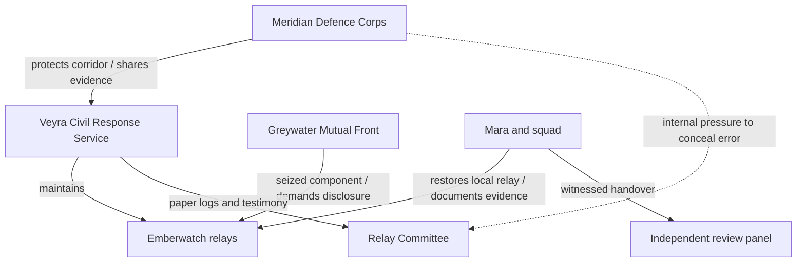

# 04 — Character and Faction Bible

**Purpose:** Standardize character identity, performance and narrative roles.  
**Status:** Proposed  
**Last reviewed:** 2026-10-19

## Character design principles

Use distinct silhouettes, restrained materials and readable facial acting at phone scale. Uniforms are invented and avoid real national insignia. Characters are adults except where future scripts explicitly justify otherwise; the MVP cast is 20+. Face shapes, body proportions, hair, gait, voice and color accents must remain consistent across cutscenes and gameplay. Avoid reducing any character to a single trait.

## Major characters

### Mara Venn — playable protagonist
- **Age / role:** 22; recruit, later Specialist; repair apprentice from Greywater Reach.
- **Visual identity:** compact athletic build; short dark curls; warm-brown skin; weatherproof slate jacket under a simple olive training vest; amber emergency-light tab on pack. Silhouette: practical gear, small tool roll, no oversized armor.
- **Personality:** observant, dry humor, quietly stubborn, empathetic. Strength: sees systems and people others overlook. Weakness: assumes she must fix every problem herself.
- **Motivation:** stop other families experiencing a warning failure like the one that separated her from her younger brother for two nights during The Long Rain. Her brother is safe; the story is not revenge-driven.
- **Voice:** concise, asks practical questions, rarely grandstands. Under pressure she names the immediate risk before proposing a plan.
- **Gameplay purpose:** teaches core mechanics; represents choices and player viewpoint.
- **Arc:** lone fixer → trusted teammate → accountable field specialist who can delegate and document uncertainty.
- **Start / end:** recruit unsure of command culture / specialist trusted to lead a joint relay recovery and preserve the record.
- **Appears:** all missions.
- **Animation needs:** locomotion blend tree, cautious look, tool interaction, aim, hit reaction, help/revive, dialogue idle, tired post-mission breath, three levels of concern/relief.

### Ivo Senn — rival cadet and eventual partner
- **Age / role:** 23; high-performing cadet from Lumen Bay.
- **Visual identity:** tall, lean; close-cropped hair; clean lines, neatly maintained training gear with a blue-grey shoulder marker; precise posture.
- **Personality:** disciplined, competitive, values clarity; weakness is overreliance on written process and embarrassment when uncertain.
- **Motivation:** earn a public commission to restore his family's confidence after a parent was blamed for an unrelated logistics failure.
- **Voice:** polished, careful language early; uses first names and shorter sentences once trust grows.
- **Gameplay purpose:** rival tutorial partner; creates disagreement about when to deviate from an order.
- **Arc:** score-first competitor → skeptical collaborator → advocate for transparent evidence and shared credit.
- **Start / end:** believes perfect procedure prevents error / understands procedure needs judgment and accountability.
- **Appears:** M01, M02, M03, M05; optional radio lines elsewhere.
- **Animation needs:** inspection, composed idle, reluctant smile, defensive look, reconciliation, assisting NPC.

### Captain Leena Or — academy field instructor
- **Age / role:** 41; instructor, former emergency corridor coordinator.
- **Visual identity:** medium height; greying undercut; dark uniform with minimal insignia; orange rescue-cord loop on belt.
- **Personality:** direct, patient, protective but not paternalistic. Carries regret about a previous evacuation decision.
- **Motivation:** make recruits useful under ambiguity rather than merely obedient during drills.
- **Voice:** grounded, measured; asks questions instead of speechifying. Her praise is specific.
- **Gameplay purpose:** tutorial guide, mission briefings, moral counterweight to institutional secrecy.
- **Arc:** cautious mentor worried about reputational damage → openly supports transparent review and shared responsibility.
- **Start / end:** protects the academy by controlling information / protects people and institution by telling the truth with evidence.
- **Appears:** M01, M02, M04, M05 and menus.
- **Animation needs:** briefing, arms-rested idle, mapscreen gesture, quiet apology, ending acknowledgment.

### Soren Vale — Greywater Mutual Front leader
- **Age / role:** 46; former civil engineer, community organizer and disputed GMF leader.
- **Visual identity:** broad-shouldered, weather-worn, long salt-grey beard; patched rain cape over practical workwear; old survey tag at collar. Not a villain uniform.
- **Personality:** protective, persuasive, strategic; weakness is believing that withholding context is justified when others cannot be trusted.
- **Motivation:** prevent central authorities from burying the timeline and force resources back to the coast.
- **Voice:** low, precise and rarely loud. Speaks about practical consequences; refuses melodrama.
- **Gameplay purpose:** antagonist whose actions create conflict but whose grievances contain truth.
- **Arc:** uses control of a relay component as leverage → accepts a witnessed evidence handover once rescue and review are guaranteed.
- **Start / end:** distrustful and coercive / held accountable but willing to cooperate on immediate public safety.
- **Appears:** M03, M04, M05.
- **Animation needs:** observant idle, clipped gesture, guarded conversation, decision pause, handing over a log case.

### Nadi Quill — VCRS relay technician
- **Age / role:** 35; repair lead for the warning relay network.
- **Visual identity:** wiry; cropped black hair; utility overalls with reflective strips; grease-pencil marks on gloves; portable tool case.
- **Personality:** curious, unsentimental, funny when nervous; cares about evidence quality.
- **Motivation:** recover a verifiable maintenance record and keep residents from losing confidence in the warning system.
- **Voice:** technical but plain-spoken; defines jargon in one sentence.
- **Gameplay purpose:** interaction target, gives the player repair objectives and evidence context without exposition dumps.
- **Arc:** isolated technician who fears being scapegoated → public witness who separates known facts from inference.
- **Appears:** M02, M03, M05.
- **Animation needs:** panel interaction, tool use, stress tells, pointing to log mismatch, relief.

### Jun Aras — squad medic and calm anchor
- **Age / role:** 27; field medic trainee, active companion.
- **Visual identity:** medium build; close-cropped curls; sand-colored medical pack with a teal cross-like fictional abstract mark that is not a real service emblem.
- **Personality:** warm, candid, practical; weakness is hiding their own exhaustion to support others.
- **Motivation:** make evacuation feel humane rather than logistical.
- **Voice:** soft but clear, uses names, avoids sarcasm when stakes are high.
- **Gameplay purpose:** companion support, injury feedback, civilian rescue beats.
- **Arc:** tries to carry every burden alone → shares responsibility with Mara and the squad.
- **Appears:** M01, M02, M04, M05.
- **Animation needs:** follow/run, helping civilian, utility use, concern/relief, safe idle.

### Rafi Daro — civilian shelter coordinator
- **Age / role:** 54; resident coordinator of a Greywater shelter.
- **Visual identity:** sturdy older adult; silver hair; mustard rain jacket; paper roster and handheld lamp.
- **Personality:** outspoken, pragmatic, remembers names; distrusts military promises but cooperates when actions match words.
- **Motivation:** keep the shelter's residents accounted for and make the warning route usable again.
- **Voice:** direct, often asks for a concrete next step.
- **Gameplay purpose:** grounds mission stakes in human consequences and gives optional objectives meaning.
- **Arc:** expects another failed promise → becomes a witness to repair, without being asked to forgive institutions wholesale.
- **Appears:** M01, M02, M05.

## Faction relationship map

## Voice, performance and asset rules

- No character may have a line that claims an unproven inference as fact; use “we know”, “we suspect” and “we still need to verify” distinctly.
- Never use multiple characters to repeat the same exposition. Let props, logs and player interactions carry some facts.
- Dialogue should normally fit in 1–3 subtitle lines on a phone; split long information into playable beats.
- Face rig target: six core expression families (neutral, concern, frustration, relief, resolve, grief) plus phoneme support where voice is recorded.
- MVP may use text-first dialogue with limited barks; full voice casting is a later budget decision.
- Faction art cannot use real flags, real military badges or copied unit patches.

## Related documents

[Story canon](03_STORY_WORLD_AND_LORE.md) · [Mission appearances](05_CAMPAIGN_AND_MISSION_DESIGN.md) · [Asset conventions](16_ASSET_PIPELINE_AND_FILE_CONVENTIONS.md)
