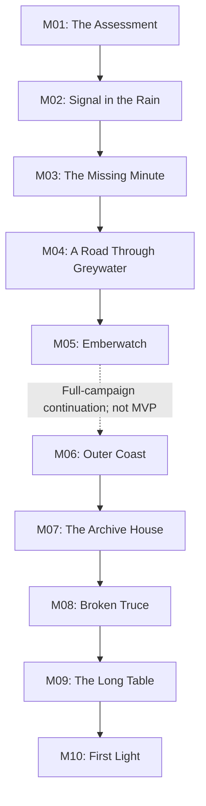

# 05 — Campaign and Mission Design

**Purpose:** Specify a complete story arc and each mission's playable structure.  
**Status:** Proposed; mission count and durations are estimates  
**Last reviewed:** 2026-10-19

## Scope model

- **Phase 1 vertical slice:** M01 in a compact academy-to-relay incident environment, with movement, interaction, one light encounter or hazard, a shelter decision, checkpoint and debrief. Target 8–12 minutes.
- **MVP campaign target:** M01–M05, five missions that resolve the local Greywater crisis. Estimated 35–55 minutes total, excluding retries and optional practice; must be validated with playtests.
- **Longer-term campaign:** M06–M10, only after the five-mission build succeeds. These extend world scope but are not needed to understand the ending.

## Campaign map

## MVP mission list

| ID / title | Type | Primary mechanic | Target | Release tier |
|---|---|---|---:|---|
| M01 — The Assessment | Training / rescue choice | Movement, camera, interaction, simple decision | 8–12 min | MVP vertical slice |
| M02 — Signal in the Rain | Relay recovery / escort | Exploration, companion follow, hazard navigation | 7–10 min | MVP |
| M03 — The Missing Minute | Reconnaissance / low-pressure stealth | Observation, interactable evidence, suspicion | 8–12 min | MVP |
| M04 — A Road Through Greywater | Rescue / short combat | Squad order, civilian escort, controlled encounter | 8–12 min | MVP |
| M05 — Emberwatch | Climax / repair / handover | Coordinate teammates, protect relay, choose evidence handover | 10–14 min | MVP |

## Detailed mission specifications

### M01 — The Assessment
**Location:** Meridian Academy training yard, then a connected mock shelter courtyard.  
**Purpose:** Introduce Mara, Ivo and Captain Or; show that the crisis reaches beyond a score board.  
**Briefing:** Recruits must complete a time-boxed equipment and movement assessment. A live relief request arrives from a nearby practice-linked shelter after a storm barrier jams.  
**Starting situation:** Player stands beside a marked route board. A short camera pan reveals the yard; control returns quickly.  
**Primary objective:** Reach the shelter and help activate the emergency gate.  
**Optional objective:** Complete three safe target markers on the range before leaving.  
**Sequence:** movement/look tutorial → interact with route board → optional marker exercise → gate controls tutorial → shelter decision `CHOICE_01_SHELTER` → debrief.  
**Challenges:** one jammed gate, a timed route element with generous margin, no lethal enemy encounter.  
**Checkpoint:** after first gate interaction; before final decision.  
**Failure/restart:** falling into a marked hazard returns to checkpoint; timer expires only loses bonus score, never the story.  
**Reward:** 100 XP, Recruit commendation, academy board unlock.  
**Characters:** Mara, Ivo, Captain Or, Jun cameo, Rafi via radio/brief encounter.  
**Cinematics/dialogue:** opening 15–25 seconds, two short instructor exchanges, optional shelter reaction; all skippable after first view.  
**Acceptance:** player finishes within 12 minutes on first-time path; all prompts can be dismissed/reopened; choice flag persists.  
**Assets/performance:** one academy yard modular set, 4 character rigs reused, one gate prop, simple crowd silhouettes limited to background.  
**Next link:** Captain Or sends Mara and Ivo to support a real relay recovery, noting their teamwork gap.

### M02 — Signal in the Rain
**Location:** Greywater cliff road and North Relay exterior.  
**Purpose:** Shift from safe training to a real rescue task; establish Emberwatch as public infrastructure.  
**Briefing:** Restore a beacon long enough to guide a small evacuation group to a safe shelter.  
**Start:** Rainy roadside, Jun with Mara; North Relay visible across a broken service walk.  
**Primary:** reach the station and restore power to the local beacon.  
**Optional:** retrieve the maintenance kit left by Nadi Quill.  
**Mechanics:** traversal, camera navigation, Follow companion state, one non-combat hazard, interact-and-hold repair prompt.  
**Route:** road sign → flooded footbridge with alternate dry route → relay perimeter → manual breaker → shelter marker.  
**Challenges:** wind audio, wet surfaces visually conveyed but movement remains predictable; no random lightning damage.  
**Checkpoint:** entry to relay perimeter; again before breaker interaction.  
**Failure:** falling or health depletion resets checkpoint; evacuation group waits safely while player recovers.  
**Reward:** 80 XP; utility flare unlock for later authored signal moment; relationship with Jun rises based on optional kit.  
**Characters:** Mara, Jun, Nadi (radio), Ivo (radio).  
**Duration/difficulty:** 7–10 min, low-medium.  
**Completion:** relay emits a stable signal and shelter marker confirms arrival.  
**Next link:** a local log indicates the official outage time predates the storm peak.

### M03 — The Missing Minute
**Location:** North Relay maintenance room and adjacent archive shed.  
**Purpose:** Introduce the central mystery without a long exposition dump; portray GMF as suspicious but not fully understood.  
**Briefing:** Nadi asks the squad to verify the relay log before transferring it to central command.  
**Primary:** recover an authenticated copy of the maintenance record.  
**Optional:** collect three physical timestamps from a work ticket, backup panel and dispatch label.  
**Mechanics:** low-pressure stealth/suspicion, observation, examine evidence, choice `CHOICE_02_RECORD`.  
**Route:** entry panel → dark control room with backup lighting → paper archive shed → safe extraction marker.  
**Encounters:** one GMF lookout who investigates noise and can be avoided or calmly confronted; if seen, encounter escalates but doesn't end mission. No forced takedown.  
**Checkpoint:** after log terminal is powered.  
**Failure:** alert triggers a brief retreat to checkpoint; all collected evidence before checkpoint persists only if it has been recorded.  
**Reward:** 80 XP; codex file “The Missing Minute”; one future dialogue variant.  
**Characters:** Mara, Ivo, Nadi, Soren voice/radio cameo.  
**Duration/difficulty:** 8–12 min, medium.  
**Completion:** player retrieves a corroborated record; narrative labels inference as unresolved.  
**Next link:** GMF holds a relay component needed to restore the secondary route.

### M04 — A Road Through Greywater
**Location:** hillside access road, abandoned weigh station, shelter approach.  
**Purpose:** Show the human cost of the dispute and test squad coordination.  
**Briefing:** Jun identifies a delayed relief group. Mara's squad must reopen the safe road and guide people past the damaged weigh station.  
**Primary:** escort civilians to a marked sheltered zone.  
**Optional:** use the companion Assist order to secure a blocked path without taking a shortcut.  
**Mechanics:** Follow/Hold/Assist orders, short stylized combat against a small hostile group, escort proximity and regroup behavior.  
**Route:** overlook briefing → road barrier → encounter around abandoned equipment → regroup point → shelter arrival.  
**Challenges:** no civilian can be hit or selected as a target; the squad provides clear warnings before a hostile encounter.  
**Checkpoint:** after road barrier cleared; another at the regroup point.  
**Failure:** if escort NPC is separated, a visible regroup timer pauses at safety zones; fail only if authored danger state completes.  
**Reward:** 120 XP; Jun relationship scene; unlocks final relay approach.  
**Characters:** Mara, Jun, Ivo, Rafi, GMF patrol.  
**Duration/difficulty:** 8–12 min, medium.  
**Completion:** all key evacuees reach safety and player has a meeting time for the handover.  
**Next link:** Captain Or negotiates a time-limited joint recovery at Emberwatch.

### M05 — Emberwatch
**Location:** North Relay control platform, maintenance bay and beacon rooftop.  
**Purpose:** Deliver action climax, choose an accountable evidence handover, resolve the local story.  
**Briefing:** Restore the secondary relay before the next storm band. GMF representatives will return the missing component only if the log is transferred for review.  
**Primary:** restore the relay, protect the repair window, and complete the witnessed handover.  
**Optional:** preserve all three corroborating timestamps for the fullest epilogue record.  
**Mechanics:** repair interaction, timed but generous hold-the-position encounter, companion order, decision `CHOICE_03_HANDOVER`.  
**Route:** meet Nadi and Soren at a neutral entry → retrieve component → activate backup → brief defense encounter → rooftop signal test → evidence handover → debrief.  
**Threats:** one contained wave with clear spawn cues; falling debris is telegraphed; no unlimited enemy spawns.  
**Checkpoint:** before component insertion, before the final rooftop sequence.  
**Failure:** restarting never deletes collected evidence; timed repair window pauses during an accessibility pause or system interruption.  
**Reward:** 140 XP; Specialist promotion; full local ending, credits/codex; optional epilogue text depends on evidence and choices.  
**Characters:** full MVP cast.  
**Cinematics:** relay light sequence, short witnessed handover and 30–45 second ending; final sequence skippable after first view.  
**Duration/difficulty:** 10–14 min, medium-hard.  
**Completion:** North and East relays broadcast verified status, evacuation routes reopen, and a review panel receives authenticated evidence.  
**Closure:** Mara takes responsibility for decisions, Ivo credits the team, Soren is not absolved but agrees to the review, and Captain Or commits to transparent testimony. Further questions are hinted at without making the outcome feel incomplete.

## Longer-term proposed missions (not MVP commitments)

| ID / title | Concept | New production risk | Gate |
|---|---|---|---|
| M06 — Outer Coast | Search a weather station and help a stranded communications crew. | New biome and sea-level effects. | Only after MVP stability. |
| M07 — The Archive House | Investigate paper records in an abandoned records center. | More narrative props and branching conversations. | Reuse existing interior kit first. |
| M08 — Broken Truce | Negotiate a passage through competing local groups. | More NPC logic and dialogue variation. | Requires narrative cost estimate. |
| M09 — The Long Table | Protect a public review meeting from disruption without combat-first design. | Multi-character staging and audio complexity. | Requires performance/cinematic spike. |
| M10 — First Light | Restore a wider warning loop and close a second regional incident. | New locations and expanded cast. | Only if player research supports an expansion. |

## Post-MVP continuation mission specifications (not required for the first complete release)

These five missions extend the regional accountability arc after M05 has already delivered a complete local resolution. In the full ten-mission vision they form the wider campaign’s second half; the five-mission MVP ending remains complete and is not a cliffhanger. Every mission below remains **Deferred** until the MVP is stable.

### M06 — Outer Coast (Deferred)
- **Location / purpose:** an isolated weather station on the outer coast; show that Emberwatch maintenance gaps extend beyond Greywater, without undoing the M05 resolution.
- **Briefing / start:** VCRS asks the team to check a backup gauge after an unanswered scheduled status ping. Mara and Jun arrive at a wind-battered service landing with the station visible above the shore.
- **Primary / optional objective:** locate the station crew and restore a safe communications beacon; optionally recover the hand-written maintenance roster.
- **Mechanics / route:** environmental traversal and relay interaction; landing path → wind-shielded stairway → station room → exterior signal mast → safe extraction point. Wind affects ambience and visual particles only; no uncontrollable physics.
- **Characters / challenges:** Mara, Jun, Nadi via radio and two civilian technicians; slippery-looking surfaces must use predictable collision. No mandatory combat.
- **Checkpoint / failure:** checkpoint at station entry; fall hazard respawns player at the last safe platform; no loss of M01–M05 progress.
- **Reward / connection:** 120 XP-equivalent post-campaign record score, storm-map codex entry and a lead to the archive records. Duration 7–10 min, low-medium difficulty.
- **Cinematic/assets/performance:** one 8-second beacon-wide shot; reuse coastal modular kit, add weather-station shell and mast; cap visible particles on low profile. Completion means crew accounted for and authenticated ping sent.

### M07 — The Archive House (Deferred)
- **Location / purpose:** a municipal archive building where analogue maintenance records survived a network upgrade; introduce provenance and evidence handling.
- **Briefing / start:** Nadi asks Mara to compare the North Relay log against a public maintenance ledger while a review panel is being assembled. Start at a flooded lobby, with a dry upper records room.
- **Primary / optional objective:** recover and cross-reference three records; optionally return a family-held copy to its owner rather than retaining it as evidence.
- **Mechanics / route:** exploration, object inspection, light navigation puzzle and dialogue; lobby → records index → secured shelf → evidence table → exit. No lock-picking or real-world procedural detail.
- **Characters / challenges:** Mara, Ivo, Nadi, Rafi and one archive caretaker; challenge is interpretation, not enemy waves. One room is temporarily inaccessible until a safe route is cleared.
- **Checkpoint / failure:** after index restoration; inspection progress persists after checkpoint, while a mistaken comparison causes a helpful hint rather than hard failure.
- **Reward / connection:** codex “Maintenance Timeline”; opens a public hearing mission. Duration 8–11 min, medium difficulty.
- **Assets/performance:** reuse interior kit and evidence prop family; 3 unique hero documents with large legible headings; no tiny required text. Completion means all mandatory timestamps are corroborated and uncertainty labels are retained.

### M08 — Broken Truce (Deferred)
- **Location / purpose:** a checkpoint at a washed-out bridge; test negotiation and mutual aid rather than treating combat as the default answer.
- **Briefing / start:** an aid vehicle cannot pass because the MDC and a GMF group disagree over who controls the crossing. Mara is assigned to escort a neutral repair crew to assess a safe detour.
- **Primary / optional objective:** secure a mutually accepted passage for the repair crew; optionally return a supply crate mistakenly held by one side.
- **Mechanics / route:** dialogue choice, route scouting, short environmental traversal and possible bounded defensive encounter only if a misunderstanding escalates. Approach → speak with both representatives → inspect damaged crossing from safe viewpoint → choose a witnessed detour plan → guide repair crew to staging zone.
- **Characters / challenges:** Mara, Ivo, Soren, a VCRS driver and two checkpoint representatives. No option labels a faction wholly good/evil; consequences are clear and local.
- **Checkpoint / failure:** after first conversation; wrong assumptions trigger extra dialogue or a longer route, not mission lockout. Any hostile escalation is finite and avoidable.
- **Reward / connection:** trust/relationship scene and public-hearing context. Duration 8–12 min, medium difficulty.
- **Cinematic/assets/performance:** short bridge establishing shot; reuse road and barrier assets, add bridge span only if feasible; cap NPC count. Completion means aid crew reaches designated safe staging and no faction is falsely described as having surrendered.

### M09 — The Long Table (Deferred)
- **Location / purpose:** a public relief coordination hall; bring the story's evidence and disagreements into a non-combat climax.
- **Briefing / start:** the independent review panel convenes witnesses from MDC, VCRS and the GMF. Mara's role is to ensure the authenticated log and witness order are delivered without interruption.
- **Primary / optional objective:** deliver and verify the evidence packet; optionally ensure each witness has a chance to submit a statement.
- **Mechanics / route:** dialogue, staging, evidence matching and crowd readability; check-in desk → witness waiting area → evidence table → public chamber → quiet debrief. No stealth takedown or combat required.
- **Characters / challenges:** Mara, Ivo, Captain Or, Soren, Nadi, Rafi and panel chair. Conflict emerges from incompatible accounts; player distinguishes confirmed facts from interpretation.
- **Checkpoint / failure:** after evidence verification; a mistaken packet order prompts re-check rather than discarding evidence. Leaving early pauses the meeting and resumes safely.
- **Reward / connection:** campaign trust states and a formal restoration mandate, leading to M10. Duration 8–12 min, medium narrative difficulty.
- **Assets/performance:** one reconfigurable hall, 7 named characters maximum in camera, controlled audio mix and limited facial animation layers. Completion means panel receives records and records unresolved facts explicitly.

### M10 — First Light (Deferred)
- **Location / purpose:** final coordinated relay test at a hilltop repeater; conclude the broader accountability arc and affirm that public safety is shared work.
- **Briefing / start:** with the review underway, a regional test window opens. The team must route a verified warning signal through a chain of three relays while a storm front approaches.
- **Primary / optional objective:** complete the authored system test and confirm the evacuation message reaches all three test beacons; optionally include every verified maintenance note in the public archive.
- **Mechanics / route:** traversal, one repair interaction per relay, squad assist and short finite defense while the mast is powered; staging area → relay A → cable bridge → relay B → hilltop relay C → signal confirmation and epilogue.
- **Characters / challenges:** Mara, Jun, Ivo, Nadi, Captain Or and one VCRS crew. Environmental pressure is telegraphed and timers pause in cinematic/pause states.
- **Checkpoint / failure:** after each relay stage; power sequence restarts from latest stage; no campaign-progress loss. No random storms or unbounded enemies.
- **Reward / ending:** final rank/commendation and a conclusive region-wide epilogue; the wider warning network is operating under documented review and shared maintenance, with no required sequel hook. Duration 10–14 min, medium-hard.
- **Cinematic/assets/performance:** final relay line shot, 30–45 second skippable epilogue, reuse environment kit plus one hilltop mast. Completion criteria include all three test beacons reporting, final save verified and credits/codex unlocked.

## Mission quality gate

Every mission must have a primary/optional objective list; clear route; short objective copy; checkpoint; success/failure flow; dialogue and flags; required asset manifest; performance budget; save/retry tests; and at least one non-combat beat. Mission names, IDs and outcome keys are stable identifiers—do not rename after save data or analytics are authored without a migration plan.
