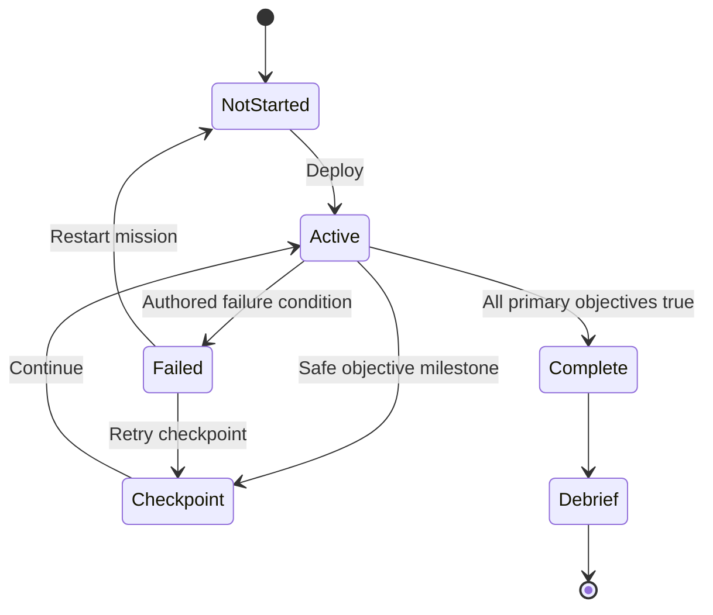

# 06 — Gameplay Mechanics

**Purpose:** Convert the GDD into implementable rules and edge cases.  
**Status:** Proposed / Needs Validation where noted  
**Last reviewed:** 2026-10-19

## Mechanic specification template

Each system below defines input, response, feedback, edge cases and acceptance criteria. Numbers marked “tune” are experiment parameters, not final balance values.

## MECH-001 — Third-person movement
- **Input:** left virtual stick; sprint button.
- **Rules:** input is camera-relative on the ground plane. Acceleration and deceleration are tuned to avoid slippery movement; sprint is a separate movement state. Character rotation follows movement direction unless aiming.
- **Response:** responsive animation blend among idle, walk, jog, sprint, turn-in-place and stop.
- **Feedback:** footstep sounds by surface family, light dust/water effects at quality-dependent density, small haptic cue only for selected interactions.
- **Edge cases:** joystick cancel on focus loss; block input during non-skippable critical animation; if player is pushed against a wall, preserve camera control and don't accumulate hidden velocity.
- **Acceptance:** a tester can traverse a 10 m straight path and stop near a marked point; no persistent drift after touch release.
- **Test:** QA-IN-001, QA-PERF-002.

## MECH-002 — Camera and aim
- **Input:** drag right region for look, aim button for shoulder aim.
- **Rules:** pitch/zoom bounds configurable; camera collision shortens boom behind walls; sensitivity has at least three stops or a slider. Aim assist affects only visible hostile target capsules and synthetic range markers.
- **Response:** smooth camera rotation with no forced snap except optional low-strength assist.
- **Feedback:** reticle shape indicates free look, valid target, or obstructed line; no critical feedback via color alone.
- **Edge cases:** camera must not enter first-person view accidentally; hide obstructing character geometry only by a documented renderer rule; prevent camera from passing through doors/terrain.
- **Acceptance:** player can turn 180 degrees reliably without losing movement control; sensitivity and handedness persist after restart.
- **Test:** QA-IN-002, QA-UX-003.

## MECH-003 — Context interaction
- **Input:** tap contextual button when an interactable is in range and line of interaction is valid.
- **Rules:** nearest valid interactable wins; UI label uses authored verb (“Repair relay”, “Help resident”). Hold interactions show progress; one-tap interactions do not use hold timers.
- **Response:** animation, state change and objective update occur exactly once.
- **Feedback:** prompt appears when the player is within an authored radius; invalid target gives no false success sound.
- **Edge cases:** two interactables overlap; target moves away; mission completes during hold; interaction is interrupted by damage. Cancel safely and never duplicate reward.
- **Acceptance:** all MVP interactables can be completed with one primary action and accessible hold duration feedback.
- **Test:** QA-GAME-003.

## MECH-004 — Fictionalized combat
- **Input:** aim and fire, with an optional assisted fire mode considered for accessibility tests.
- **Rules:** fire uses a prototype-selected hitscan/projectile method; hostile actors have explicit health/state; civilians and allies are never valid targets. No penetration simulation, real weapon handling claims or detailed ballistics.
- **Response:** hit/miss feedback, target state change, limited recoil impulse, reload/empty state.
- **Feedback:** hit marker, animation response, restrained sound and no excessive camera shake.
- **Edge cases:** out of ammo; target behind cover; companion crosses view; player fires while paused; mission ends during projectile travel.
- **Acceptance:** only hostile actors can be damaged; restarting doesn't duplicate kill rewards; fire inputs are ignored while paused or in story lock.
- **Test:** QA-GAME-004, QA-SAFE-001.

## MECH-005 — Enemy awareness
- **States:** Patrol → Suspicious → Alerted → Engage/Seek Cover → Disabled/Retreat.
- **Rules:** detection is based on visible game-space and authored proximity/noise events. Alert state is readable and stable; one enemy cannot chain-spawn unlimited reinforcements.
- **Feedback:** head turn, short bark/subtitle if supported, icon or sound cue.
- **Edge cases:** line of sight blocked by transparent VFX; enemy loses nav path; player is discovered during a cutscene. Reset to a safe anchor or use a graceful alert fallback.
- **Acceptance:** the player can understand why detection increased and can recover where the level permits it.

## MECH-006 — Squad companion
- **States:** Follow, Hold, Assist.
- **Rules:** one active companion maximum in MVP. Companion never blocks required interaction; assist can be invoked only at authored support points; order selection must be reversible.
- **Feedback:** compact text/icon confirmation and a short companion acknowledgment.
- **Edge cases:** companion path invalid, falls behind, is hit by scripted hazard, or enters dialogue during order. Snap to a safe anchor only after a short delay and never in direct camera view.
- **Acceptance:** companion reaches every required mission trigger without teleporting into hazards; a failed path cannot softlock the objective.

## MECH-007 — Health and checkpoint recovery
- **Rules:** three-segment health UI. A short post-hit invulnerability window is tuned in prototype. At zero health, stop simulation, show retry options, and preserve last checkpoint data.
- **Feedback:** restrained vignette, audio cue and health segments; no rapid flashing.
- **Edge cases:** death at same frame as objective completion; app background while death menu opens; user chooses restart mission vs checkpoint.
- **Acceptance:** reward and story flags are written once; retry resolves to one deterministic state.

## MECH-008 — Training score
- **Rules:** score is bronze/silver/gold based on time, optional markers and missed prompts; exact thresholds are authored per drill. Story progression never depends on gold score.
- **Feedback:** end-of-drill breakdown lists one strength and one actionable improvement.
- **Edge cases:** skipped tutorial, accessibility slowdown, repeated drill. Use distinct score records without granting duplicate one-time unlocks.
- **Acceptance:** all thresholds are displayed before a retry and never penalize control accessibility settings.

## MECH-009 — Civilian escort
- **Rules:** escort group follows a safe lane and regroups at authored points. No complex crowd simulation. If the player moves too far away, group waits at the last safe zone and a proximity indicator appears.
- **Feedback:** count/formation indicator, clear waypoint, short civilian barks.
- **Edge cases:** one NPC is blocked; path crosses encounter area; mission failure or checkpoint occurs. Respawn the group at safe anchor when checkpoint restarts.
- **Acceptance:** all required civilians reach the destination in a clean run; a blocked NPC cannot stall longer than a configured watchdog window.

## MECH-010 — Story choice
- **Rules:** a choice has stable key, options, immediate reaction and consequence tier (`FLAVOR`, `LOCAL`, `CAMPAIGN`). The default path always reaches the complete ending.
- **Feedback:** option copy includes concrete action, not moral labels. Choice outcome is reflected in dialogue/debrief.
- **Edge cases:** app closes during choice; save migration; replay asks whether to overwrite previous choice. Commit only on confirmed selection and save atomically.
- **Acceptance:** every campaign flag is covered by at least one test for every documented branch.

## MECH-011 — Pause and resume
- **Input:** pause button or Android system interruption.
- **Rules:** pause freezes all gameplay timers and AI. Resume restores state; exit to menu saves only safe snapshot/checkpoint.
- **Edge cases:** notification shade, incoming call, battery saver, window focus loss, process kill. On next launch offer Continue from last safe checkpoint, not mid-cutscene.
- **Acceptance:** 20 repeated pause/resume cycles yield no simulation speed changes or stuck inputs.

## MECH-012 — Mission objective state machine

Only the mission controller can mark completion. Each objective event is idempotent; repeating an event cannot award XP twice. A watchdog may reset a known stuck scripted sequence but must log a diagnostic reason during development builds.

## Global edge-case checklist

- Touch input released after OS interruption.
- Dialogue and gameplay input never process in the same frame unintentionally.
- Retry after XP award does not duplicate reward.
- Low-memory reload restores a safe checkpoint.
- Reduced effects settings preserve hit/mission readability.
- Localization text expansion does not cover controls.
- Accessibility options do not make any primary mission objective impossible.
- The player cannot target civilians or be rewarded for harming civilians.

## Related authorities

[GDD](02_MASTER_GAME_DESIGN_DOCUMENT.md) · [Mission design](05_CAMPAIGN_AND_MISSION_DESIGN.md) · [UI screen specs](08_UI_UX_AND_SCREEN_SPECIFICATIONS.md) · [QA cases](20_TESTING_AND_QUALITY_ASSURANCE.md)
