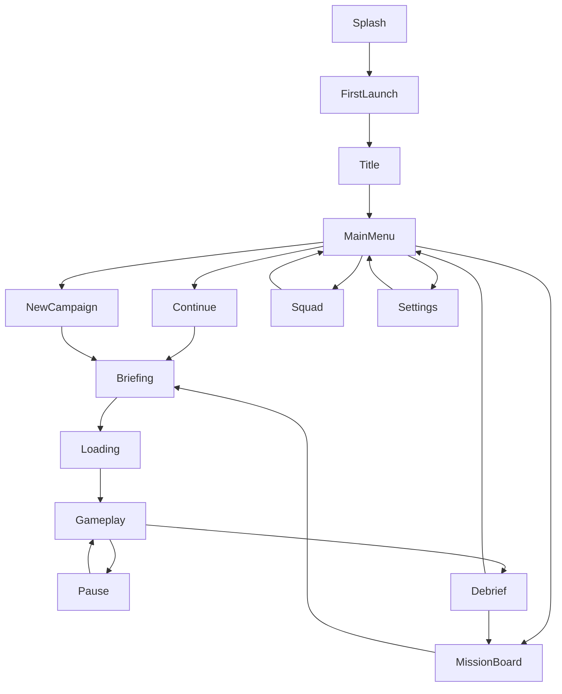

# 08 — UI/UX and Screen Specifications

**Purpose:** Define information architecture, key screens and responsive rules before visual implementation.  
**Status:** Proposed  
**Last reviewed:** 2026-10-19

## UX principles and tokens

- Landscape-first for gameplay; menus also use landscape to avoid disruptive rotation.
- Show one primary action per screen; secondary actions remain discoverable but visually quieter.
- No cluttered tactical readouts, decorative fake telemetry or gradients as the default visual language.
- UI copy is plain-language, localized through keys and readable over both light and dark imagery.
- Important state uses icon + text/shape, not color alone.
- Touch target baseline: 48dp where feasible; spacing must prevent frequent mis-taps.

### Design tokens (proposed)

| Token | Value | Use |
|---|---|---|
| `color.ink` | `#171E22` | Primary text / darkest panels |
| `color.slate` | `#26343B` | Menu panels |
| `color.steel` | `#53656D` | Secondary surfaces |
| `color.ash` | `#D7DEE0` | Lines and muted labels |
| `color.paper` | `#F3F0E7` | High-contrast text / bright surface |
| `color.signal` | `#E6A34B` | Primary action / objective accent |
| `color.safe` | `#68A88B` | Safe / completed cue, paired with icon |
| `color.warning` | `#D96B55` | Danger / attention, paired with icon |
| `space.1..6` | 4, 8, 12, 16, 24, 32dp | Spacing scale |
| `radius.panel` | 8dp | Panels and cards |
| `radius.button` | 6dp | Buttons |
| `type.title` | 28–36sp | Title/display |
| `type.heading` | 20–24sp | Screen headings |
| `type.body` | 16–18sp | Main body/subtitles |
| `type.caption` | 14sp minimum target | Metadata and hints |

Use a modern humanist sans-serif with robust Android glyph coverage; confirm font license and language support. Avoid condensed display fonts for body text.

## Navigation model



System back: closes an open dialog first, then a submenu, then returns to Main Menu; during gameplay it opens Pause and never exits directly. Back from Main Menu asks for confirmation only if a relevant unsaved modal state exists.

## Screen specification matrix

The entries below cover every required screen. The screen names are stable UI identifiers; implementation may combine screens only if all states/actions remain clear.

| ID / Screen | Purpose and hierarchy | Primary / secondary actions | States, back behavior and acceptance |
|---|---|---|---|
| UI-01 Splash / initialization | Logo mark, progress indicator, version/dev marker in debug only | None | Loading/error retry; no false progress. Continue to first launch/title. |
| UI-02 First launch / onboarding | Control overview, privacy/legal links, comfort settings | Begin / Adjust controls / Accessibility | Skip tutorial only after preferences; no account required. Back returns to prior onboarding step. |
| UI-03 Title | Cinematic still/video loop with title and “Press to continue” | Continue | Asset fallback to still image; low quality disables video. |
| UI-04 Main menu | Continue, New Campaign, Mission Board, Squad, Settings, Credits | Continue or New Campaign | Continue disabled with empty save and explains why. Back asks exit confirmation. |
| UI-05 Continue campaign | Resume card with chapter, last checkpoint and timestamp | Resume / Mission Board / Delete save | Corrupt save shows recovery; deletion requires explicit confirmation and states what is lost. |
| UI-06 New campaign | Warning that previous save may be replaced; difficulty and control setup | Start / Cancel | Save overwrite confirmation; no silent reset. |
| UI-07 Chapter / mission selection | Chapter map card, mission list, completion marks | Select unlocked mission | Locked missions explain unlock condition. Back to menu. |
| UI-08 Mission briefing | Objective, risk notes, squad, optional task, estimated duration | Deploy / Loadout / Back | If data loads slowly show skeleton; no mission begins until Deploy. |
| UI-09 Loading / transition | Location art, one gameplay tip, compact objective | None | Cancel not available during safe loading; recover to prior screen on load error. |
| UI-10 In-game HUD | Objective top-left, health and utility bottom-left, move stick left, look/aim/fire right, pause top-right | Move, aim, fire, interact, utility, pause | Prompt appears/disappears by range; supports handedness and scale settings. |
| UI-11 Pause menu | Mission status and buttons | Resume / Restart checkpoint / Restart mission / Settings / Exit to menu | Gameplay frozen; restart/exit confirms loss of unsaved in-mission state. |
| UI-12 Objective update | Small title, objective text, directional marker | Dismiss only if non-critical | Auto-dismiss after readable interval; remains in journal; not stacked over dialogue. |
| UI-13 Dialogue / choice | Character portrait/body, name/callsign, subtitle, 2–3 options | Choose / Continue | Text scale and background opacity; voice setting honored; choice commit is explicit. |
| UI-14 Mission completion | Result heading, medal, rewards, story beat | Continue / Replay / Mission Board | Reward award idempotent; no duplicate XP after retry. |
| UI-15 Mission failure / retry | Plain failure reason and checkpoint label | Retry checkpoint / Restart mission / Quit | Pause state not leaking; choice confirmed when progress loss occurs. |
| UI-16 Academy training selection | Drill cards, skill focus, best medal | Start / Practice / Back | Empty records state shows “Not attempted”; never claims completed. |
| UI-17 Character / squad profile | Character art, biography, relationship band, seen scenes | View codex / Return | All labels readable; locked story notes say “Not discovered yet.” |
| UI-18 Skills / progression | XP bar, rank title, skill cards and point count | Unlock / Refund if MVP supports it | Disabled skill explains requirement; confirmation before spend/refund. |
| UI-19 Equipment / loadout | Cosmetic model preview, utility description | Equip / Reset appearance | Preview fallback; story-essential item cannot be unequipped. |
| UI-20 Rewards / promotions | Promotion animation, item and next objective | Continue | Reduce-motion setting shortens animation; skip never loses reward. |
| UI-21 Campaign map | Simplified Veyra map with current mission and completed markers | Select mission / open briefing | No real map service or GPS; map works offline and is stylized, not navigable geography. |
| UI-22 Codex / story archive | Filter by characters, places, evidence | Open entry / Mark read | Empty state explains entries unlock through story; reading doesn't alter flags. |
| UI-23 Settings | Controls, audio, graphics, accessibility, legal | Save / Reset defaults | Auto-save settings; reset confirmation; no modal trap. |
| UI-24 Audio | Master, music, ambience, dialogue, SFX sliders | Save / Test sound | Sliders update live; mute persists; missing audio asset degrades gracefully. |
| UI-25 Graphics / performance | Quality preset, frame-rate target, effects, resolution scale where supported | Apply / Reset | Restart warning only when truly needed; unsupported options hidden. |
| UI-26 Accessibility | Text scale, subtitle backdrop, contrast cues, aim assist, control scale, left-handed mode, reduced motion, vibration | Apply / Reset | Preview sample; all changes persist across sessions. |
| UI-27 Save-data recovery | Status, latest safe checkpoint, recover/erase options | Recover / Delete / Back | Never overwrite a valid save silently; errors use non-technical language and debug detail only in dev builds. |
| UI-28 Privacy / legal | Privacy policy, licensing, credits, support contact placeholder to be filled before release | Open / Copy diagnostics in dev only | No fake URLs; release checklist blocks shipping until legal contact and policy URL are real. |

## Landscape wireframes

### Main menu

```text
┌─────────────────────────────────────────────────────────────────────┐
│ OPERATION: EMBERWATCH                                [Settings ⚙]    │
│                                                                     │
│             [Hero: Mara silhouette / storm-lit relay]               │
│                                                                     │
│   [ CONTINUE CAMPAIGN ]    [ NEW CAMPAIGN ]                          │
│   [ MISSION BOARD ]        [ SQUAD & CODEX ]                         │
│                                                                     │
│  RECRUIT • CHAPTER 1                                  [Credits]      │
└─────────────────────────────────────────────────────────────────────┘
```

### In-game HUD

```text
┌─────────────────────────────────────────────────────────────────────┐
│ OBJECTIVE: Restore the north relay                        [Pause]    │
│                                                                     │
│                         WORLD / PLAYER                              │
│                                                                     │
│ (Move stick)                                  [Aim] [Fire]           │
│ [Health ▰ ▰ ▱] [Utility]                   [Interact: Repair relay]  │
└─────────────────────────────────────────────────────────────────────┘
```

## Responsive and accessibility requirements

- Use safe areas for cutouts and landscape system bars; test both left and right display cutouts.
- UI scales by available safe-area width, not only device model name.
- Avoid placing essential controls within gesture navigation edge zones.
- Provide subtitles for every voiced story line and meaningful combat barks; use a readable opaque/semi-opaque backdrop.
- Support text size setting within authored bounds without clipping choice buttons.
- Use icons plus labels for uncommon actions; haptics are supplemental only.
- Respect system audio focus interruption and restore levels safely.
- Provide reduce-motion option for title loops, camera shakes and reward animations.
- Check contrast in bright daylight, not only in a darkened room.

## Acceptance checklist

1. Every screen can be reached via documented navigation and has a return path.
2. Main and in-game actions have minimum practical touch size and adequate separation.
3. Loading, empty, unavailable and error states use authored copy.
4. System back and Android interruptions never discard progress silently.
5. No screen depends on network availability.
6. All text is string-keyed and can expand by at least 35% without covering primary actions.
7. Accessibility settings are persisted and included in regression tests.

## Related documents

[Art direction](09_VISUAL_ART_DIRECTION.md) · [Gameplay](06_GAMEPLAY_MECHANICS.md) · [Data/save](15_DATA_MODEL_AND_SAVE_SYSTEM.md) · [QA](20_TESTING_AND_QUALITY_ASSURANCE.md)
