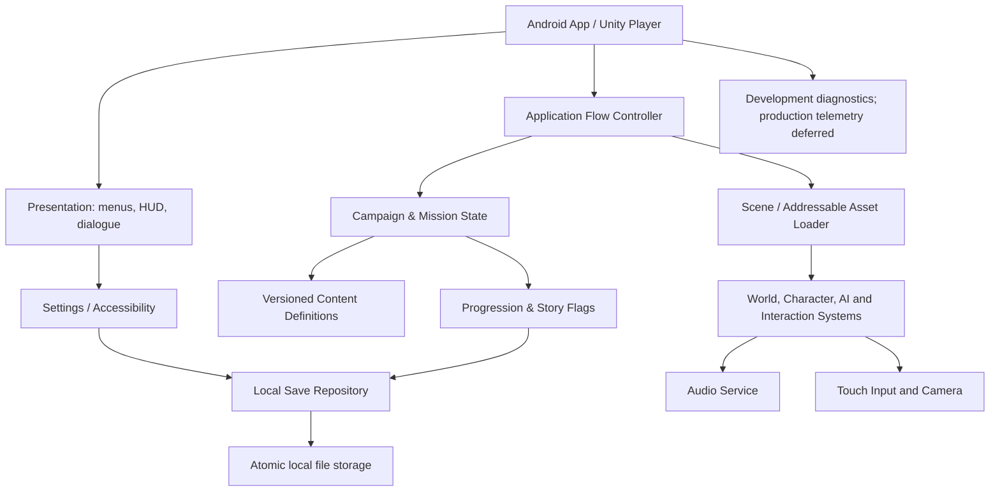
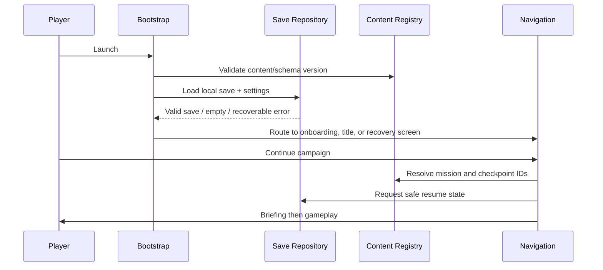

# 12 — Technical Architecture

**Purpose:** Define runtime boundaries and the smallest architecture that supports the game.  
**Status:** Proposed; validate during Phase 0  
**Last reviewed:** 2026-10-19

## Recommendation

Use a dedicated engine for the full MVP runtime. Under the current product vision, **Unity owns gameplay, all in-game UI, scene management, character controllers, animation, rendering, audio, input, mission flow and local persistence**. This avoids the risk and duplicated lifecycle of embedding one runtime inside another. A React Native shell or companion application is deferred. If owner/team skills or commercial licensing materially change, compare Godot during the Phase 0 spike and record a decision rather than attempting a hybrid by default.

## Architecture diagram

## Module ownership

| Module | Owns | Must not own |
|---|---|---|
| App bootstrap | initialization, platform checks, safe fallback route | mission story rules |
| Navigation/Screen flow | title → menu → briefing → gameplay → debrief; back behavior | raw save-file serialization |
| Mission controller | objective state machine, checkpoints, failure/completion events | rendering details or UI copy generation |
| Player controller | movement, camera intent, input interpretation | progression rewards |
| Interaction system | interactable registry, prompt and single interaction commit | story branch decisions outside authored data |
| Character/AI | finite NPC state machines and safe navigation | permanent player save state |
| Dialogue/choice | line sequence, choice keys, consequence dispatch | directly editing save JSON from UI handlers |
| Progression service | XP, rank, skills, idempotent rewards | scene loading |
| Save repository | schema version, serialization, atomic write and recovery | deciding game rules |
| Content registry | mission definitions, objective IDs, localization keys, asset IDs | player progress mutations |
| Audio service | buses, transitions, pause/ducking, event-to-sound mapping | dialogue story canon |
| Settings/accessibility | preference validation and apply hooks | core mission conditions |
| Diagnostics | build ID, error codes, frame-time captures in debug | collecting personal information by default |

## Data flow and event rules

- Systems communicate through typed events or explicit services with one owner for important state.
- UI reads state and sends commands; UI does not set mission completion or award XP directly.
- Mission objective transitions are idempotent: a duplicate event cannot award twice.
- Player save state is separated from static mission/character content.
- Scene transitions use one orchestrator and explicit loading/ready/error states.
- All asset references use stable identifiers; avoid unvalidated string lookups at mission runtime.
- Development diagnostics capture failing mission ID, objective ID, checkpoint ID, build version and stack/error code without identity or precise location.

## Startup flow

## Content configuration

Mission data defines `missionId`, `chapterId`, `entrySceneId`, objective records, optional objective IDs, checkpoint IDs, character/asset IDs, dialogue keys, reward keys, exit conditions and diagnostic watchdog ID. Static content is validated in editor/CI before a build. Player progress stores keys/flags, not duplicated mission definitions.

## Asset loading and memory

Use the chosen engine's supported asynchronous scene/asset loading mechanism. Keep common UI and player systems resident only if memory tests justify it; unload mission-only assets after exit. On low-memory warning, stop preloading optional cinematics and reduce transient effects; avoid dropping required textures or UI fonts. If a load fails, return to a safe menu with an error code and retry action rather than displaying a blank screen.

## Local save service

- Write to a temporary file, flush/close, validate the result, then atomically replace the previous file when platform semantics permit.
- Retain one backup of the last known-good save.
- Store `schemaVersion`, `contentVersion`, `saveTimestamp`, `playerProfile`, `campaignState`, `settings` and checksum/validation fields as appropriate.
- Migrate in ordered schema steps. Unknown newer schema: preserve original file and present a recovery/compatibility message; do not overwrite it.
- Encrypting the local save is not required for single-player integrity, but protect it from partial writes and malformed data.

## Offline-first behavior

MVP has no sign-in, API, cloud save or network-dependent mission. Do not request internet permission unless the actual build introduces a documented need. Static store/update traffic is handled by Play, outside the game runtime. Core flow remains available after airplane mode is enabled following installation.

## Error handling and observability

Classify recoverable content/load error, save corruption, mission state mismatch, missing asset, script exception, input focus loss and performance budget warning. Player-facing messages stay simple; debug builds log detailed IDs/stack traces. Release crash reporting SDK is deferred until its value, collection and privacy disclosures are reviewed.

## Dependency and build policy

- Use exact engine/editor version and package versions pinned in project manifests.
- Avoid unmaintained plugins and packages with broad permissions.
- Record native plugin, SDK or Gradle changes in decision log and validate clean Android builds.
- Keep signing credentials out of source control.
- Reproduce release builds from a clean checkout and written toolchain list.

## Security boundaries

There are no API keys in the MVP because there are no third-party runtime APIs. Never place private signing keys, passwords or unneeded personal data in assets or Markdown. If a future service is introduced, keep secrets in a server-side environment and complete threat/privacy reviews before integrating.

## Related documents

[Technology choice](13_TECH_STACK_AND_RENDERING_DECISION.md) · [RN plan](14_REACT_NATIVE_IMPLEMENTATION_PLAN.md) · [Save model](15_DATA_MODEL_AND_SAVE_SYSTEM.md) · [Performance](17_PERFORMANCE_AND_DEVICE_COMPATIBILITY.md) · [Release](21_GOOGLE_PLAY_RELEASE_PLAN.md)
